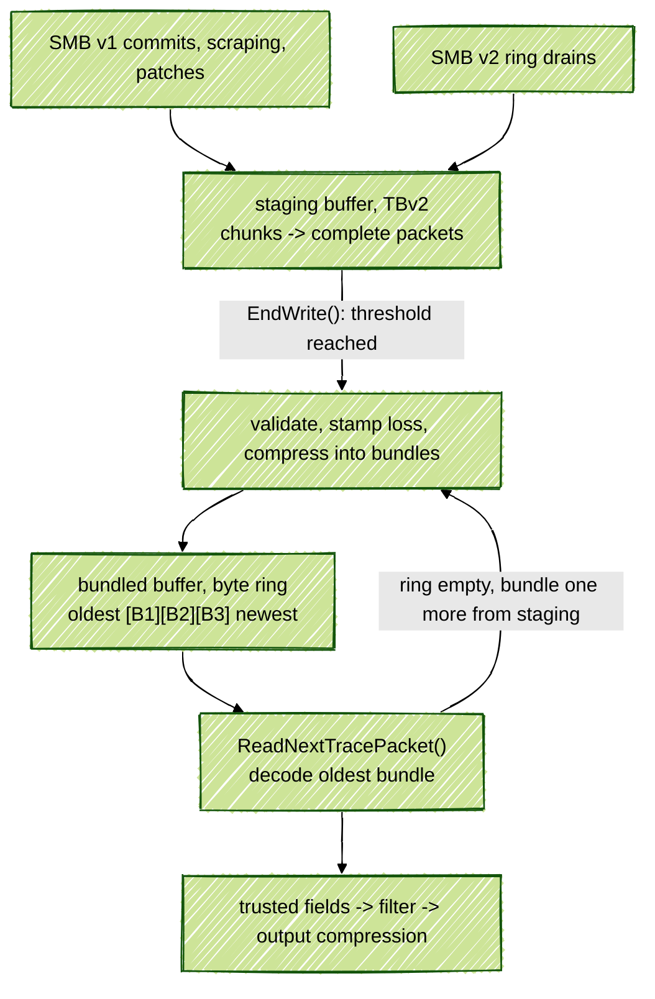

# TBv3 = TBv2 + a buffer of compressed bundles

**Authors:** @primiano @rsavitski @sashwinbalaji

**Status:** Draft

This RFC describes the layout and flow of TraceBuffer V3 (TBv3).

The flow starts just like today, the tracing service copies producer chunks
(SMB v1 and SMB v2) into the trace buffer. But now that buffer is a staging
area. Periodically we read its chunks as complete trace packets, bundle and
compress them into a second buffer, which is a plain ring.

## Requirements

- Support both SMB v1 and v2 chunks.
- No behavior change for caller and callee of trace buffer. ReadBuffers
  should return the same way as it does today.

## Overview



So TBv3 has two buffers.

- Staging buffer
  - The current TBv2 dealing with all the complexity of SMB v1 and SMB v2 chunks.
  - The last place in the v2 flow where "perfetto proto group"
    exists. Once a packet leaves staging, it is in normal protobuf form.
- Bundled buffer
  - A pure ring buffer. It does not need to care about padding or patches.
  - A bundle written into it is complete in itself.

So for each sequence, every packet in the bundled buffer is older than every
packet of that sequence in staging. And once we make a bundle, it doesn't
change and nobody outside the buffer holds a pointer into it.

So it would look roughly like this.

```cpp
class TraceBufferV3 : public TraceBuffer {
  std::unique_ptr<TraceBufferV2> staging_buf_;
  BundledBuffer bundled_buf_;

  // TBv3 also owns the bundle builder, decode arena and sequence map.
};
```

## How chunks reach the staging buffer

No change in this flow. The tracing service calls these functions in write batches of consecutive
calls that copy chunks (and apply patches) in one go.

1. v2 uses DrainV2RingBuffer() -> ServiceRingBufferDrainer::Drain() ->
   CopyChunkV2Untrusted().
2. v1: CommitData -> CopyProducerPageIntoLogBuffer() ->
   CopyChunkUntrusted().
3. v1: ScrapeSharedMemoryBuffers() -> ForEachScrapableChunk() ->
   CopyProducerPageIntoLogBuffer() -> CopyChunkUntrusted().

   The scraping case. It walks the SMB page by page, so the chunks of one
   writer can come out of ChunkID order.

The service makes these calls through the TraceBuffer interface, so it does
not care whether the buffer is a TBv2 or a TBv3.

## When do we bundle packets from staging

A bundling pass reads complete packets from staging, compresses them into one
or more bundles, stores them in the bundled buffer, and compacts staging.

We set a threshold, bundle_target_bytes, for how much new chunk data can
arrive in staging before we run another bundling pass.

Now the question is where exactly we check this threshold and start bundling.

Doing it through a separate periodic PostTask seems like unnecessary
complexity. Doing it only at read time is too late because at that point we
might as well bypass bundling and write to the file. We want bundling to make
room while data is still coming in, so we can write more. So the write path
seems like the best place, and the bundling pass should be much like a
periodic readback.

The obvious place would be inside CopyChunkxxUntrusted. Count the chunk bytes
copied and run a bundling pass once we cross bundle_target_bytes.

But with SMB v1 chunks that won't work for two reasons.

1. Scraping means chunks can be out of order.
   - During a scrape we scan the SMB in linear order and commit chunks as we
     find them. That linear order is the chunk allocation order, which is
     unpredictable, so chunks are effectively committed in random order.
   - TBv2 relies on all the out-of-order commits of one scrape arriving together, atomically, before
     any read.
   - Bundling in the middle of a scrape breaks that. If it runs between two
     copies of the same scrape, a chunk that comes later in page order but
     earlier in ChunkID order arrives after the bundling pass has already read
     past its position. TBv2 then discards it as older than the last chunk
     read.

   ```text
   SMB of P, in page order:   page 2: chunk 7 of W
                              page 9: chunk 6 of W

   Bundling inside CopyChunkUntrusted():

     CopyChunkUntrusted(W, chunk 7)
       bundle_target_bytes is reached, so bundling starts now.
       It reads W. After chunk 5 it finds chunk 7.
       That looks like a hole. The packets of chunk 7 go out
       with a loss flag.
     CopyChunkUntrusted(W, chunk 6)
       Chunk 6 is older than the last chunk read, which is 7.
       TBv2 discards it.
   ```

2. Patches are copied after the chunks (minor).
   - CommitData carries a list of chunks followed by a list of patches. We
     copy the chunks first, then ApplyChunkPatches() applies their patches
     through TryPatchChunkContents().
   - A packet split across chunks cannot be read until its first chunk is
     patched.
   - So a bundling pass inside CopyChunkUntrusted() finds that chunk still
     waiting for a patch that is a few lines further down in the same message.
     It leaves it, and everything the writer wrote after it, in staging.
   - Nothing is lost, the bundling pass just does less than it could.

**The proposal is to introduce EndWrite().**

- MaybeCompact() already gives the buffer a chance to change its state once
  the service has finished using the read slices. EndWrite() tells it that
  a write batch is done.
- Call it after the chunks and patches of a CommitData, after scraping one
  producer and after draining a v2 ring. TBv1 and TBv2 do nothing in it.
- Check how many bytes staging accepted since the last pass. Reset the count
  even if nothing was readable, so waiting for a patch does not trigger a
  pass on every EndWrite().

We also need to bundle during a read once the bundled buffer is empty but
staging still has readable packets. That ignores the threshold and builds one
bundle at a time. We get to that flow below.

## How do we bundle packets from staging

We start by reading staging with the same BeginRead() and
ReadNextTracePacket() as today, then compress the packets we get back.

1. Start the staging read with BeginRead(), then
   ReadNextTracePacket() in a loop. We get the same behavior as the TBv2 reader.
   - Fragments are reassembled into complete packets.
   - A sequence waiting for a patch or a missing fragment waits in staging.
     Packets from other sequences can still be bundled.
   - A scraped incomplete chunk gives us its complete packets. Its unfinished
     tail waits for the later commit.
   - RewriteProtoGroupPacket() converts SMB v2 packets into normal protobuf.
   - Each packet comes with its PacketSequenceProperties and its
     previous_packet_on_sequence_dropped reason bits.
2. Validate each packet. If staging reports loss, combine those bits with any
   previous_packet_dropped already in the packet and append that field.
   Keep its identity in TBv3's sequence map and add its ProducerAndWriterID
   to this bundle's sequence list the first time it appears. Feed the packet
   into zstd, with a small header saying whose packet it is and its size.
3. When the bundle is ready, finish the zstd frame and build its header and
   sequence list. Make room in the bundled buffer, then copy the whole thing
   into it.
4. When there are no more readable packets, finish the last bundle and compact
   staging with TBv2's shift-left compaction. This removes the consumed chunks'
   padding and keeps the chunks we could not bundle. Use CompactIfWritable()
   so DISCARD can also reuse this space while staging still accepts writes.

To start with, I would use zstd level 3. RFC-0038 measured zstd-3 as roughly
break-even with today's trace size at a fraction of the CPU
(ref: https://github.com/google/perfetto/discussions/6397).

### When do we finish one bundle

For now, we use bundle_target_bytes for both, incoming chunk bytes to start
bundling and uncompressed trace packet bytes plus their small headers to
finish a bundle. We can split this into two variables later.

- Add the whole packet, then finish the bundle if we reach or cross
  bundle_target_bytes.
- If ReadNextTracePacket() returns false, finish what we have.

We only know a packet's size after reading it from staging. Adding it before
checking the total saves us keeping a separate copy for the next bundle.

- EndWrite() keeps building bundles until staging has no more readable packets.
- On readback, after the bundled buffer drains, build one bundle and return
  all its packets before building the next.

A record is often two varints and a small packet, and calling zstd costs more
than copying a few bytes. So gather small pieces in a 4 KiB buffer and pass
them to zstd together.

### Add loss to TracePacket before bundling

When a packet leaves staging, add its loss bits to previous_packet_dropped,
combining them with any bits already in the packet. That saves us carrying
the loss separately through the bundle.

Today ReadBuffers() calls PacketStreamValidator::Validate() when returning
packets to the consumer. For TBv3, do that here before adding the loss field,
because adding a field could make a malformed packet pass validation. Drop
invalid packets and count each once in the existing stats.

If a dropped packet carried a loss flag from staging, put the flag back so
the next valid packet of that sequence reports it.

Have Validate() return the packet's own loss bits too. TBv3 returns true
from validates_packets(), so ReadBuffers() skips the second validation.

The service still adds uid, pid, machine ID and trusted sequence ID when it
returns the packet to the consumer.

## What a bundle looks like

Each bundle we store in BundledBuffer has three parts.

```text
 +-------------+-------------------------+----------------------+
 | header      | sequence list           | compressed packets   |
 | 12 bytes    | 4 bytes per sequence    | one zstd frame       |
 +-------------+-------------------------+----------------------+
```

```cpp
struct BundleHeader {          // 12 bytes
  uint32_t bundle_size;        // Header + sequence list + compressed bytes.
  uint32_t uncompressed_size;  // Packet bytes + their small headers.
  uint32_t num_sequences;
};

// Followed by num_sequences ProducerAndWriterID entries, then the zstd frame.
```

### Header

- bundle_size: size of the whole bundle, We need it to skip a bundle, to make room for a new one and to advance
  the read position.
- uncompressed_size: memory to reserve when decoding. We also
  check that zstd produced that many bytes.
- num_sequences: Number of ProducerAndWriterID in the packets, also tells us where where the compressed
  bytes start.

### Sequence list and identity

We put each sequence in the list once using ProducerAndWriterID.

The uid, pid and machine ID live in TBv3's map, in a ClientIdentity for each
sequence. We get that identity from TBv2's PacketSequenceProperties when
bundling and copy it into the map.

### Inside the compressed bytes

Each trace packet has two varints before it.

```text
 compressed bytes --zstd--> record, record, record, ...

 one record: [sequence_index][packet_size][packet bytes]
                  varint        varint
```

- `sequence_index` points into the sequence list above.
- `packet_size` tells us where this packet ends and the next record starts.

**Open question:** Todo for later, would grouping the sequence and sizes
before the packet bytes compress better?

### Why we keep the header and sequence list uncompressed

We need the header and sequence list when overwriting. We need to know which
sequences lost packets, and we don't want to decode the whole bundle just to
find them. So we keep the header and sequence list outside zstd.

## How the bundled buffer stores these bundles

The bundled buffer is one flat piece of memory of size_kb * 1024 bytes.

```cpp
class BundledBuffer {
  base::PagedMemory mem_;  // The capacity, size_kb * 1024 bytes.
  uint64_t wr_ = 0;        // Write cursor. Where the next bundle goes.
  uint64_t rd_ = 0;        // Read cursor. Where the oldest bundle starts.
};
```

wr_ and rd_ count bytes in the logical stream, and wr_ - rd_ is
the amount in use. The byte at position p lives at `p % capacity`.

```text
 Logical positions:

              rd_                                wr_
               |                                  |
               v                                  v
               [ B3 ][ B4 ][ B5 ][       B6        ]

 The same data in memory:

 0                                                      capacity
 +----------+----------+------+-----+-----+-------------------+
 | B6 end   | free     | B3   | B4  | B5  | B6 start          |
 +----------+----------+------+-----+-----+-------------------+
            ^ wr_ offset
                       ^ rd_ offset
```

These rules hold at all times.

- `rd_ <= wr_` and `wr_ - rd_ <= capacity`.
- rd_ points to a bundle header, or equals wr_ when empty.
- One bundle starts immediately after the previous one. No alignment or
  padding between them.
- Reads and overwrites both remove data at rd_. New bundles go at wr_.

Both counters are uint64_t and count bytes, so they should never wrap in
practice.

- Assume 1 GB/s of compressed output, 10^9 bytes per second.
- The time to overflow is 2^64 / 10^9 = ~585 years.

Hopefully no tracing session lives that long. So we can treat these counters
as only growing and leave out wrap handling.

Reset both to zero when empty, so frequent drains reuse the first pages.

### Appending, including when the ring wraps

Say we have a 2 MiB ring in RING_BUFFER mode, with 1.9 MiB used. We want to
append a 0.2 MiB bundle.

1. Only 0.1 MiB is free, so we need to remove the oldest bundle. Do the bookkeeping for it and advance rd_ by
   bundle_size, say 0.3 MiB. Repeat if we still need more room.
2. We now have 0.4 MiB free. Copy 0.1 MiB at the end of the ring and the
   remaining 0.1 MiB at offset zero.
3. Advance wr_ to 2.1 MiB.

```text
 Before:
   | oldest: 0.3  |       other bundles        | free: 0.1 |
   0              0.3                          1.9         2.0
   ^ rd_ = 0                                   ^ wr_ = 1.9

 After:
   |new end| free |       other bundles        | new start |
   0       0.1   0.3                           1.9         2.0
                 ^ rd_ = 0.3
           ^ wr_ = 2.1, which is offset 0.1
```

Letting a bundle wrap avoids padding at the end. The copy takes at most two
pieces. Copy a wrapped frame into contiguous scratch before decoding it.

Overwriting only needs the header and sequence list, unless ProtoVM needs
the packets too. Then we decode them.

## How packets go back to the consumer

ReadBuffers() calls BeginRead(), then ReadNextTracePacket() in a loop.
The service can call MaybeCompact() afterwards if compaction is enabled.

Read bundles from oldest to newest, then bundle and read staging. For each
sequence, staging holds the newer packets.

### Reading one bundle

1. At rd_, read BundleHeader and decode the zstd frame into
   uncompressed_size bytes of the decode arena.
2. Look up its sequences in TBv3's map and cache their PacketSequenceProperties
   by sequence_index. Set read_offset to zero.
3. Each ReadNextTracePacket() reads the two varints at read_offset and combines
   the packet's loss bits with any unreported loss for that sequence.
   Return slices into the decoded bytes and advance read_offset.

Split large packets into slices to fit the IPC sender's size limit. After
the last packet, advance rd_ by bundle_size and release the bundle's
sequence references. Keep the decoded bytes until the batch is delivered.

Check the decoded size, sequence IDs and record bounds. If these fail, drop
the bundle, increment bundles_corrupted and report DATA_LOSS_CHUNK_CORRUPTED
on its sequences.

### Keeping decoded bytes across batches

ReadBuffersIntoConsumer() collects about 32 KiB per task.
ReadBuffersIntoFile() uses batches of about 1 MiB. The last packet can exceed
either size, so these do not cap decode memory.

A batch can stop partway through a bundle or span several bundles. TBv2
resumes from payload_avail. TBv3 keeps the decoded bytes, read_offset and
sequence properties across BeginRead().

```text
 Bundle with 300 packets

 First batch       Return packets 1 to 40, keep the rest decoded.
 Next BeginRead()  Resume at packet 41, without decoding again.
 After packet 300  Decode the next bundle into unused space.
                   This batch may still hold slices from the old one.
```

I would use two reusable blocks, each holding several decoded bundles.
Allocate each on first use and decode into unused space at its end.

```cpp
class DecodeArena {
  struct Allocation {
    std::unique_ptr<uint8_t[]> data;  // A block has decode_block_bytes.
    size_t used = 0;                  // Bytes handed out so far.
  };

  std::array<Allocation, 2> blocks_;     // Allocated on first use.
  std::vector<Allocation> temporaries_;  // For a bundle that fits in neither.
};
```

Do not grow, move or overwrite a block while slices point into it. If neither
block has room, use a temporary allocation. Keep compression scratch separate.

The service must finish using the batch's slices before the next read batch,
write or compaction. Put that in the buffer interface.

- BeginRead() resets blocks with no unread packets and frees finished
  temporary allocations. Keep the block or allocation holding unread packets.
- MaybeCompact() also frees the blocks that are now empty.

**Open question:** how big should decode_block_bytes be? I would start at
2.25 x bundle_target_bytes, enough for about two bundles near the target
size. A large packet or a batch spanning many bundles can still need
temporary space.

### When RING_BUFFER overwrites a partly read bundle

Say EndWrite() needs space while the oldest bundle is partly read. In the
example above, packets 41 to 300 are still in the decode arena. We cannot keep
them readable and drop newer bundles to make room. RING_BUFFER should keep
the newest data.

1. Walk the decoded records from read_offset and flag loss only for sequences
   with unread packets. If ProtoVM needs the bundle, give it only those packets.
2. Drop the decoded records for that bundle and clear its read state. The
   previous batch has been delivered, so we can reuse the memory.
3. Remove the bundle and keep removing the oldest bundles until the new one
   fits. For a wholly unread bundle, its sequence list is enough to mark loss.

**Open question:** after making space, should we decode the oldest remaining
bundle into the freed scratch space, or wait for the next read? (maybe not)

### Reading what's left in staging

Staging may hold packets below bundle_target_bytes, or packets made readable
by a patch or another fragment.

Once rd_ == wr_, read any pending_bundle in DISCARD first.
ReadNextTracePacket() then uses EndWrite()'s builder even below the target.
Build and read one bundle at a time. Once staging has no more readable
packets, compact it in RING_BUFFER mode.

```text
 Read stored bundles -> read pending_bundle, if any
                               |
                               v
                Build one from staging -> read it
                         ^                    |
                         +--------------------+
```

This keeps readback from overwriting packets it has not returned yet. It
does mean compressing staging packets only to decode them immediately.
Frequent reads also make smaller bundles, which can compress less well.

## Data loss

Loss still goes in previous_packet_dropped on the next packet of that
sequence.

### A chunk is lost in staging

The bundler combines TBv2's SequenceState::data_loss_reasons with any
previous_packet_dropped bits already in the packet, then appends the combined
value before compression.

### A bundle is overwritten

TBv3 keeps unreported_loss_reasons separate from staging loss because the next
packet of that sequence may already be bundled.

```text
 Writer W:  [A: overwritten] [B: in a bundle] [C: in staging]

 Consumer next reads B -> B must report the loss of A.
 Bundling next reads C -> putting the flag here would report the loss too late.
```

On overwrite, walk the bundle's sequence list and OR DATA_LOSS_PRESENT and
DATA_LOSS_OVERWRITE into each sequence's unreported_loss_reasons. For a partly
read bundle, only mark sequences with unread packets.

When the consumer reads the next packet of that sequence, combine these bits
with its existing previous_packet_dropped and clear unreported_loss_reasons.
The decoded bundle caches a pointer to each sequence, so this needs no extra
map lookup.

If the last bundle holding a sequence goes away while loss is still pending,
the next packet of that sequence can only come from staging. Move the bits
into TBv2's data_loss_reasons then, so the bundler puts them on that packet.

### Update sequence cleanup to account for both buffers

Today DeleteStaleEmptySequences() treats a sequence as empty when
chunks.empty(). Bundling can empty that list while packets are still in the
bundled buffer, so the check needs to include both buffers.

Keep a bundle_refs count per sequence in TBv3. TBv3 tells TBv2 about it
with two calls, RetainSequence() and ReleaseSequence().

- Count each bundle once per sequence, including one being built or kept as
  pending_bundle in DISCARD. Call RetainSequence() for the first one.
- Decrement when the bundle is fully read, overwritten or discarded. When the
  count reaches zero, erase the sequence from TBv3's map and call
  ReleaseSequence().
- TBv2 only starts aging and counting a sequence as empty when chunks.empty()
  and it is not retained.

Use this rule to keep both maps in step. TBv2's SequenceState keeps the
consumed ChunkID history needed to detect gaps and any staging loss still
waiting to be reported. TBv3's map keeps the identity needed to return bundled
packets and unreported_loss_reasons.

### When a bundle is larger than the whole bundled buffer

A bundle can exceed the whole bundled buffer if a large packet compresses
poorly. By then, ReadNextTracePacket() has already consumed its packets
from staging.

I would drop it in both modes and increment bundles_too_large. Decrement
bundle_refs for each sequence it contains.

```text
 Same sequence
 [P1: already bundled] -> [P2, P3: bundle too large] -> [P4: next from staging]
                                  discarded                  ^
                                                      report the loss here
```

We need the next staging read to put the loss on P4. Add a small TBv2
helper, AddSequenceDataLoss(), to OR DATA_LOSS_PRESENT into
data_loss_reasons for each affected sequence. Also OR in any loss bits its
dropped packets already carried, otherwise dropping the bundle would erase
those earlier loss reports too.

unreported_loss_reasons goes on the next packet returned to the consumer.
That could still be P1, which came before the packets we dropped.

**Open question:** are we okay with dropping a bundle larger than the whole
buffer in both modes?

## How the fill policies work with two buffers

### RING_BUFFER

In the bundled buffer, overwrite the oldest whole bundles until the new one
fits.

In staging, bundling and compaction normally make room. But staging can
still fill in two ways.

1. **Packets aren't readable yet.** Chunks from sequences waiting for
   patches or missing fragments can build up and fill staging.
2. **A batch needs more space than staging has left.** CommitData or a scrape
   can copy several chunks before EndWrite() runs. We cannot bundle halfway
   through a scrape because its chunks can arrive out of order.

In either case, incoming chunks can overwrite packets before we bundle them.
Keep TBv2's DeleteNextChunksFor() and report the loss.

**Open question:** are we okay with keeping older packets in bundles while
losing newer ones in staging, even when the bundled buffer has free space?

### DISCARD

Here we want to keep the early data in both buffers.

While writes are still allowed, keep compacting staging after bundling so we
can reuse that space.

1. **The bundled buffer fills first.** When the next bundle fits the whole
   buffer but not the remaining space, stop bundling in EndWrite(). Keep
   accepting chunks into staging until it fills, then stop taking new chunks.

   **Open question:** TBv2 has already consumed that bundle's packets. Could
   we keep it in pending_bundle and read it after the stored bundles, before
   staging? I would do that. It needs an extra variable and a branch when
   the stored bundles have drained.

2. **Staging fills first.** Stop taking new chunks and stop bundling in
   EndWrite(), even if the bundled buffer still has room. Keep everything
   already in both buffers.

On readback, read the stored bundles first, then any pending bundle and the
packets left in staging.

Bundling in EndWrite() stays stopped after the pending bundle has been read.
A read never compacts a DISCARD staging buffer.

**Open question:** before either buffer fills, should reads free bundled
space for later writes? 

## When ProtoVM sees packets

With TBv3, we can overwrite packets in two places, staging and the bundled
buffer. We could call MaybeProcessOverwrittenPacket() from both,
but that can pass packets to ProtoVM out of order.

Say a writer emits P1, then P2 on the same sequence. We have bundled P1,
but P2 is still in staging.

```text
1. Start
   Bundled buffer [P1]    Staging [P2]

2. More chunks arrive and staging overwrites P2 before it can be bundled
   Bundled buffer [P1]    ProtoVM receives P2

3. Later, new bundles overwrite the bundle holding P1
   ProtoVM receives P1

Writer order   P1 -> P2
ProtoVM order  P2 -> P1
```

**Open question:** should we call ProtoVM only when overwriting bundles,
and report staging overwrites as ordinary packet loss? I would do that to
keep each sequence in order.

If the consumer already read part of the bundle, ProtoVM gets only the
unread packets. A bundle that nobody read is decoded only if one of its
producers has a VM.

The VMs belong to TBv3, not to its staging buffer. For that, move the ProtoVM
handling out of TBv2 into a small class that either buffer can own.

## What CloneReadOnly needs to copy

1. **Staging, as TBv2 does today.** Copy the chunk memory up to used_size_,
   wr_, the stats and TBv2's sequences_.
2. **The live bundled bytes.** Reserve the same size as the source, as TBv2
   does for its own clone. Copy `[rd_, wr_)` in logical order, with
   two memcpys if the ring wrapped. Rebase the clone to `rd_ = 0`,
   `wr_ = copied_size`.
3. **The pending bundle**, if there is one.
4. **TBv3's sequence map.** Copy identities, unreported loss and bundle
   reference counts.
5. **The position inside the oldest bundle.** Copy read_offset. If
   the source is between read tasks, the consumer already has the packets
   before that offset.
6. **The ProtoVMs.** Clone them read-only, as TBv2 does today.

On its first read, the clone decodes its oldest bundle, looks up the sequence IDs
and starts at the copied read_offset.

Once we read the copied bundles, use the same buffer for the packets left in
staging, one bundle at a time. The clone has the same capacity as its source,
so a bundle that fits there also fits here.

**Future optimization:** the clone reserves the full size even if it copies
only a few bytes. That costs address space, not memory, since we only pay for
the pages we write to. Later we can reserve just the copied bytes and grow
when a bundle from staging needs more.

## Stats

I would add these fields to BufferStats.

| Field                       | Meaning                                                      |
|-----------------------------|--------------------------------------------------------------|
| `bundles_written`           | Bundles stored                                               |
| `bundle_bytes_uncompressed` | Packet bytes and their small headers, before compression     |
| `bundle_bytes_compressed`   | Stored bytes, including the header and sequence list         |
| `bundles_overwritten`       | Bundles overwritten to make room                             |
| `bundles_too_large`         | Bundles larger than the whole bundled buffer                 |
| `bundles_corrupted`         | Bundles dropped after a decode or record check failed        |
| `bundling_max_us`           | Longest bundling pass                                        |

- During bundling, TBv2's read counters go into staging_bytes_read,
  staging_chunks_read and `staging_readaheads_*`.
- As decoded packets are returned to the consumer, update bytes_read with
  their uncompressed record sizes.
- chunks_read and `readaheads_*` stay 0, because decoding a bundle does not
  visit the original chunks.
- invalid_packets includes the packets dropped while bundling.

### A commit after its chunk was bundled

SMB v1 scraping can copy complete chunks before their CommitData arrives.
If EndWrite() bundles them in between, the staging reader consumes and
erases those copies. The later commits then hit the consumed-chunk check
in CopyChunkUntrusted().

```text
Scrape             staging [5: P] [6: Q]
EndWrite() bundles staging empty, bundle [P][Q], last_chunk_consumed records 6
CommitData 5       cmp < 0  -> chunks_discarded++
CommitData 6       cmp == 0 -> chunks_discarded++
```

P and Q are still in the bundled buffer, but chunks_discarded counts their
late commits as lost data. Without that bundling pass, CopyChunkUntrusted()
finds the existing copies and ignores the identical commits without
changing the counter.

TBv2 can already hit this when a consumer reads between the scrape and
commit. Bundling lets it happen even when the consumer hasn't read. This
path also hits a DCHECK in debug builds, so we need to handle that too.

## What TBv3 needs from TBv2

Along with TBv2's normal write and read methods, we need these additions.

- Clone() is CloneReadOnly() with the TBv2 type, for the staging of a clone.
- CompactIfWritable() is the compaction of MaybeCompact(), also for a DISCARD
  buffer while it still accepts writes.
- discards_writes() tells TBv3 that a DISCARD staging buffer has stopped.
- RetainSequence() and ReleaseSequence() keep a SequenceState while bundles
  hold its packets.
- AddSequenceDataLoss() puts loss back for packets that left staging and were
  then dropped.

The TraceBuffer interface gets EndWrite(), validates_packets() and
invalid_packets(). It also gets the SMB v2 calls and the ProtoVM access that
the service reaches today by casting to TraceBufferV2.
