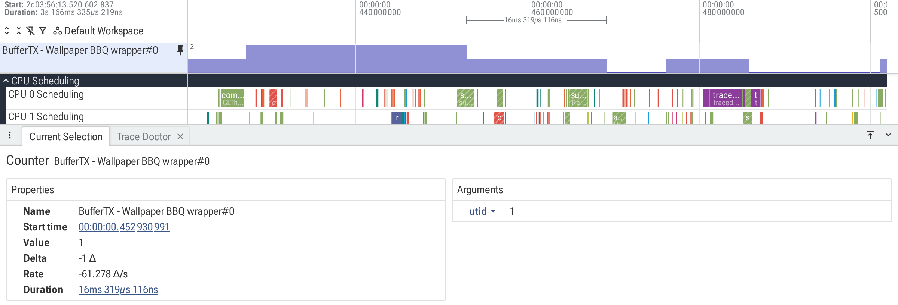
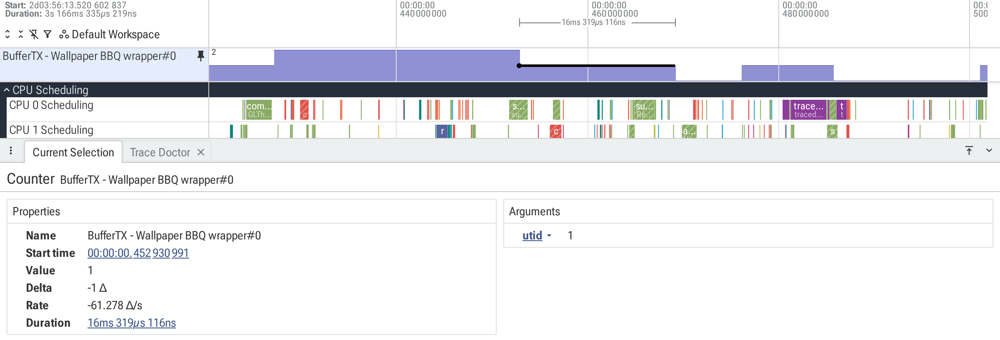
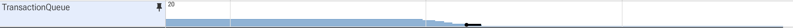
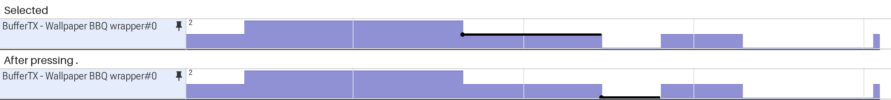
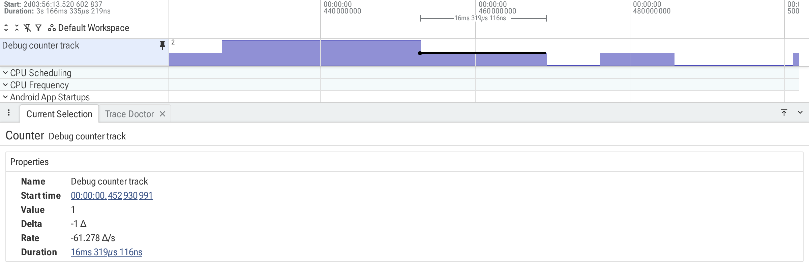
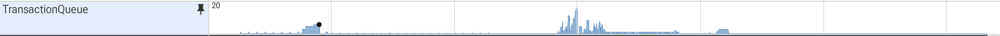

# Selecting counter samples

**Authors:** @gignat-dev

**Status:** Draft

**PRs:** [#8873](https://github.com/google/perfetto/pull/8873),
[#8874](https://github.com/google/perfetto/pull/8874),
[#8934](https://github.com/google/perfetto/pull/8934)

## Problem

Counter samples are harder to inspect than slices:

* When a sample is selected, the track doesn't show which step it is.
* `,` and `.` (previous and next event) don't work on counter tracks.
* Only trace processor counters and process state counts can be clicked, each
  with its own copy of the click code. Debug counter tracks can't be clicked.

## Decision

Pending

## Design

Three steps, one pull request each.

### 1. Highlight the selected sample (#8873)

The base counter track draws a 3 px line along the selected step and a dot of
radius 3 px at its start, in the overlay color of the slice selection outline.

It runs no query. Each drawn step starts at the last sample of its bucket and
shows that sample's value, so the selected sample is drawn if a step starts
exactly at its timestamp. Zoomed out, a sample merged with the ones after it
is highlighted only after zooming in, as slice tracks do for merged slices.

### 2. Clicks and shortcuts in the base counter track (#8874)

The base counter track handles clicks, the details panel, and `,` / `.` for
any track whose `getDataset()` lists samples with ids.
`TraceProcessorCounterTrack` and `ProcessStateCountTrack` keep only their
datasets. Tracks made with `CounterTrack.create` opt in with
`selectable: true` when their SQL has an `id` column.

### 3. Ids for debug counter tracks (#8934)

Debug counter tracks number their rows once, when their table is created
(`row_number() over (order by ts) as id`, as debug slice tracks do), and set
`selectable: true`. The query's own `id` isn't used, since it may have
duplicates.

## Alternatives considered

### Made-up ids for every counter

Number the samples on the fly, as slice tracks do when they have no `id`.

Pro:

* Every counter track becomes clickable.

Con:

* Every lookup numbers the whole track. On "Runnable thread count" in
  `android_startup_real.perfetto_trace` (308,796 samples), a click took 2.8 s
  in the UI.

### Reuse the hover's lookup

Hover finds the step drawn under the mouse. The highlight could find the step
drawn under the middle of the selected sample the same way.

Pro:

* Every selected sample gets a highlight.

Con:

* For a merged sample, the step drawn there belongs to an earlier sample, so
  the highlight sits at the wrong value. Below, the circled spike from
  section 1 has the value 1, but the dot is drawn at 6.

## Open questions

None so far.
