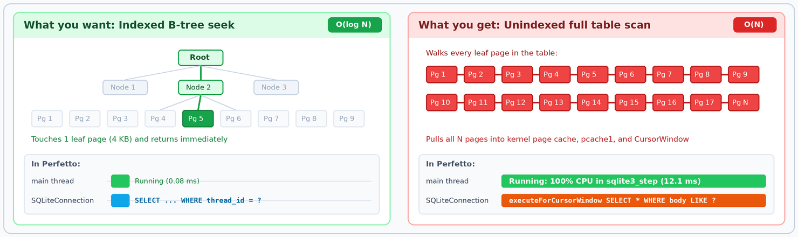
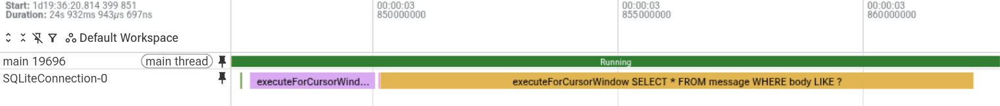
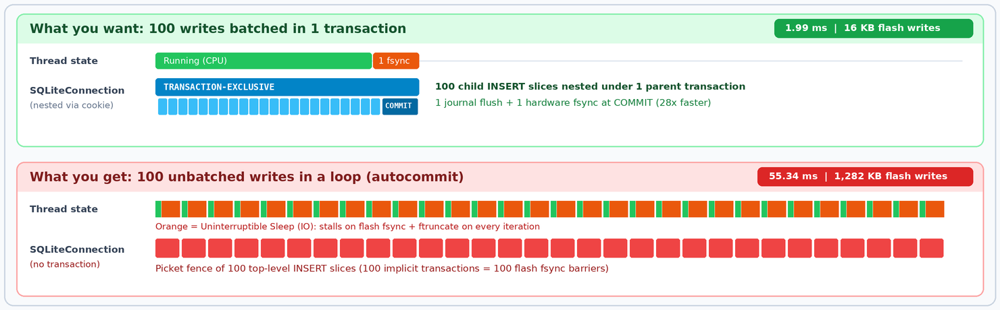
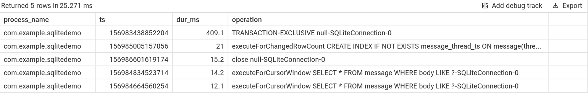
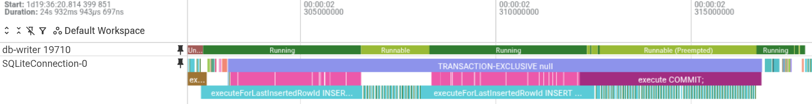
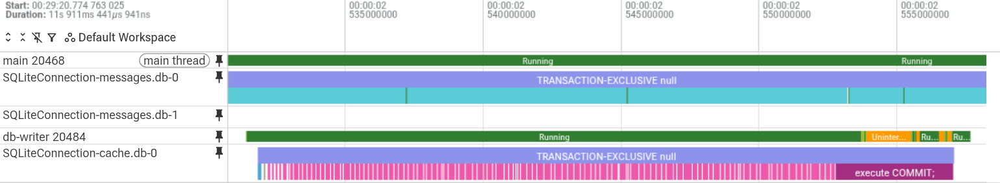

Last week I was looking at kernel memory accounting across Android devices in the field when a single number made me lose my mind for a hot second. At the 90th percentile, [Google Play services](https://developer.android.com/distribute/play-services) was holding 272 MiB of unmapped file pages in the Linux kernel page cache (and over 522 MiB at the 99th percentile). Almost all of it was cold SQLite database pages.

What made that number so unsettling is that it was completely invisible to standard Android memory profiling tools. Because Android configures SQLite with memory-mapped I/O disabled by default (`PRAGMA mmap_size = 0`, for reasons that are way outside of scope for this blog post), every database read and write goes through standard `pread64` and `pwrite64` system calls. Those file pages never map into the process virtual address space, so `dumpsys meminfo` and `/proc/$PID/smaps` report 0 KB for them. Yet under Linux control groups (`cgroup v2`), the kernel still charges every one of those unmapped cached pages directly to the app's memory footprint. Every 4 KB database page touched by an unindexed scan or a chatty background sync can end up buffered in up to three places at once: the kernel page cache, SQLite's per-connection native heap page cache (`pcache1`), and an Android [CursorWindow](https://developer.android.com/reference/android/database/CursorWindow) shared-memory buffer.

At Google, I work on Android platform system health, and as a hobby and side-hustle I also maintain the [Best practices for SQLite performance](https://developer.android.com/topic/performance/sqlite-performance-best-practices) guide on [developer.android.com](https://developer.android.com). Seeing hundreds of megabytes of hidden SQLite page cache in Google's own flagship background process kicked off a week-long blitz across Google Play services: auditing field telemetry, instrumenting a test device in the lab, fixing SQLite client issues left and right, and refreshing the public documentation and Android Lint checks with what I learned.

In this post, I share four lessons from that investigation that apply to any large Android app:

1. **The multi-tenant attribution problem:** How to look inside a massive shared process like Google Play services when process-level counters only tell you that *something* is touching the disk.
2. **Android SQLite meets Perfetto:** How to turn the rules in the [Android SQLite performance guide](https://developer.android.com/topic/performance/sqlite-performance-best-practices) into concrete visual checks in the Perfetto UI and programmatic queries in PerfettoSQL.
3. **No special sauce required:** How Android's `SQLiteConnection` tracing works under the hood using public [android.os.Trace](https://developer.android.com/reference/android/os/Trace) APIs, how I caught and fixed a track-collision bug in Android 17 along the way, and how you can build the exact same nested async tracks into your own app.
4. **Tools, not rules:** Why static lint checks cannot tell a 28x flash I/O bottleneck from a 3.2-microsecond no-op in Google Wallet, and why you should always let Perfetto and on-device measurements pick your battles.

## The attribution challenge inside Google Play services

If you have ever worked on a large mobile app where dozens of feature teams ship code into a single binary, you already understand the architecture of [Google Play services](https://developer.android.com/distribute/play-services) (`com.google.android.gms`).

To the Linux kernel, Google Play services is a single app and, for most of its services, a single long-lived process. Inside that process live dozens of independent client APIs and background services that Android apps rely on every day (see the [Google Play services API package index](https://developers.google.com/android/reference/packages)): Maps, Location, Firebase, Cast, Google Wallet, Nearby Connections, Autofill, Credential Manager, SafetyNet, and the experiment flag delivery system.

When I inspected a live test device running a normal user workload, that single Google Play services process held **26 active SQLite connection pools** and over **230 database file references**.

Process-level metrics are useless at that scale. Knowing that `com.google.android.gms` accumulated 272 MiB of kernel file cache or spent several seconds of CPU time inside `sqlite3_step` is like getting a massive water bill for an apartment building with 80 units and one shared water meter. Before you can fix anything, you need tools that show you *which* database, *which* connection pool, *which* SQL query, and *which* calling thread or incoming Binder IPC is doing the work.

## Turn Android SQLite best practices into Perfetto workflows

When I refreshed the [Best practices for SQLite performance](https://developer.android.com/topic/performance/sqlite-performance-best-practices) guide alongside this audit, my goal was to connect every recommendation in the rulebook to observable signals on a real device.

At a quick glance from `adb shell`, [dumpsys dbinfo](https://developer.android.com/topic/performance/sqlite-performance-best-practices#dumpsys-dbinfo) and [dumpsys meminfo](https://developer.android.com/topic/performance/sqlite-performance-best-practices#dumpsys-meminfo) give you cumulative per-database counters. That is how I immediately spotted that on my test device, a single database in Google Play services (`phenotype.db`, which stores feature flag configurations) executed **231,239 SQL statements**, accounting for **98.1% of all SQLite queries in the entire process**. On longer-running dogfood devices, [dumpsys meminfo](https://developer.android.com/topic/performance/sqlite-performance-best-practices#dumpsys-meminfo) showed `phenotype.db` thrashing its 25-slot prepared statement cache with a **39.1% miss rate** (**232,671 misses** out of **594,799** statement prepares).

Cumulative counters tell you *where* the volume is, but they cannot show you *when* queries run, whether they block the UI thread or a critical Binder thread pool, whether writes are batched inside transactions, or whether slow queries are CPU-bound or blocked on flash I/O. That is where [Perfetto](https://perfetto.dev) comes in.

### Record an Android SQLite trace

Android's `SQLiteConnection` instruments every database operation under the `database` atrace category (`Trace.TRACE_TAG_DATABASE`). Pairing `database` with kernel scheduler events (`sched_switch`, `sched_waking`, and `sched_blocked_reason`) lets you see both the exact SQL text and what the executing thread was doing at the kernel level:

```proto
buffers: {
  size_kb: 65536
  fill_policy: DISCARD
}
data_sources: {
  config {
    name: "linux.ftrace"
    ftrace_config {
      ftrace_events: "sched/sched_switch"
      ftrace_events: "sched/sched_waking"
      ftrace_events: "sched/sched_blocked_reason"
      atrace_categories: "database"
      atrace_categories: "binder_driver"
      atrace_apps: "*"
    }
  }
}
data_sources: {
  config {
    name: "linux.process_stats"
    process_stats_config {
      scan_all_processes_on_start: true
    }
  }
}
duration_ms: 15000
```

> **Note:** Perfetto intentionally records the parameterized SQL template (with `?` placeholders) rather than bound parameter values unless detailed debug logging is enabled on a debuggable build. This is done for privacy reasons, since showing queries with bound values can expose Personally Identifiable Information (PII). The SQLite and Perfetto integration gives you the power of full observability where debugging is explicitly permitted, while respecting user privacy when there is a doubt. Ironically, this also makes unparameterized queries jump right off the screen in a trace, because hardcoded literals like `WHERE creation_time_usec <= 1730419200` show up directly in the slice names!

### Inspect SQLite tracks in the Perfetto UI

When you open the trace in [ui.perfetto.dev](https://ui.perfetto.dev) and expand your app's process group, Android renders async tracks showing every `open`, `close`, `prepare`, `execute*`, and `TRANSACTION-*` operation, paired with `START-` and `END-` instant markers on the calling thread's track.

Pinning your app's main thread (or a suspected background worker thread) directly above the `SQLiteConnection` track turns the [Android SQLite best practices](https://developer.android.com/topic/performance/sqlite-performance-best-practices) into visual patterns you can spot in seconds.

#### Full table scans and missing indexes

Querying a table without an index ([Accelerate queries with indexes](https://developer.android.com/topic/performance/sqlite-performance-best-practices#accelerate-queries)) is like looking for a single term in a 500-page textbook by reading every page from cover to cover instead of flipping to the index at the back. Instead of following a 3-hop B-tree path to a single 4 KB leaf page, SQLite pulls every leaf page of the table into the kernel page cache and steps through every row in CPU (`sqlite3_step`). In Perfetto, this shows up as a wide `executeForCursorWindow SELECT * FROM ...` bar on the connection track aligned with a solid green `Running` bar on the calling thread's scheduler state track:



Here is what that 12.1 ms unindexed `SELECT * FROM message WHERE body LIKE ?` table scan looks like on a live trace in the Perfetto UI:



#### Unbatched autocommit write loops

When you batch 100 row insertions inside a single explicit [SQLiteDatabase.beginTransaction()](https://developer.android.com/reference/android/database/sqlite/SQLiteDatabase#beginTransaction()) block ([Batch multiple insertions in a single transaction](https://developer.android.com/topic/performance/sqlite-performance-best-practices#batch-multiple)), Perfetto renders one wide `TRANSACTION-EXCLUSIVE` or `TRANSACTION-IMMEDIATE` parent slice on the connection track with 100 tiny `executeForLastInsertedRowId INSERT ...` child slices nested underneath it, followed by a single `execute COMMIT;` and one flash `fsync` at the end. If you forget `beginTransaction()`, SQLite wraps each individual `INSERT` in its own implicit transaction, producing a picket fence of 100 top-level `INSERT` slices aligned with 100 orange `Uninterruptible Sleep (IO)` stalls on the calling thread track as the kernel blocks on flash `fsync` barriers:



### Audit SQLite at scale with four PerfettoSQL queries

Clicking **Query (SQL)** in the left sidebar of the Perfetto UI lets you audit every process and thread in the trace using [**PerfettoSQL**](https://perfetto.dev/docs/analysis/perfetto-sql-getting-started) and the [Perfetto Standard Library](https://perfetto.dev/docs/analysis/stdlib-docs). Here are four concise queries I used during the audit to map best-practice violations across the entire system.

#### Find the most frequent SQLite operations per process

This query works across all Android versions and counts every `open`, `close`, `prepare`, `execute*`, and `TRANSACTION-*` slice per process:

```sql
INCLUDE PERFETTO MODULE slices.with_context;

SELECT
  process_name,
  name AS operation,
  COUNT(*) AS count
FROM process_slice
WHERE name GLOB 'open *' OR name GLOB 'close *'
  OR name GLOB 'prepare *' OR name GLOB 'execute*'
  OR name GLOB 'TRANSACTION-*'
GROUP BY process_name, name
ORDER BY count DESC
LIMIT 10;
```

In my trace, this immediately surfaced two anti-patterns in Google Play services:

* **5,107 executions of `prepare PRAGMA user_version;`:** A context database helper was calling [db.setVersion()](https://developer.android.com/reference/android/database/sqlite/SQLiteDatabase#setVersion(int)) and running 10 `CREATE INDEX IF NOT EXISTS` statements inside its [onOpen()](https://developer.android.com/reference/android/database/sqlite/SQLiteOpenHelper#onOpen(android.database.sqlite.SQLiteDatabase)) callback every time a connection reopened after a 30-second idle timeout ([Keep schema changes out of the open callback](https://developer.android.com/topic/performance/sqlite-performance-best-practices#schema-out-of-open)).
* **Hundreds of distinct slice names differing only by a literal ID or timestamp:** Instead of one row with a count of 500 for `DELETE FROM notifications WHERE creation_time_usec <= ?`, unparameterized `String.format` queries show up as 500 separate rows with a count of 1, evicting every other compiled statement from the connection's 25-slot LRU cache ([Parameterize queries](https://developer.android.com/topic/performance/sqlite-performance-best-practices#parameterize-queries)).

#### Find main-thread SQLite operations longer than 1 ms

In Android 17 and higher, `SQLiteConnection` emits `START-` and `END-` instant events on the calling thread's track for every transaction and top-level statement (used by this query and the next two). On Android 16 and earlier, `SQLiteConnection` only emitted process-wide `Trace.asyncTraceBegin` slices with no calling thread ID and no transaction slices, so framework `database` traces alone cannot attribute queries to a specific thread on older releases unless you correlate timestamps against Room or app [`Trace.beginSection()`](https://developer.android.com/reference/android/os/Trace#beginSection(java.lang.String)) spans on `thread_slice` (or enable slow-query `logcat` logging via `adb shell setprop log.tag.SQLiteSlowQueries VERBOSE`).

Pairing those `START-` and `END-` instants with `LEAD()` over `thread_slice` gives exact per-thread wall-clock durations and attributes work back to the calling thread:

```sql
INCLUDE PERFETTO MODULE slices.with_context;

WITH marks AS (
  SELECT
    process_name, utid, is_main_thread, ts, name,
    LEAD(ts) OVER (PARTITION BY utid ORDER BY ts) AS end_ts,
    LEAD(name) OVER (PARTITION BY utid ORDER BY ts) AS end_name
  FROM thread_slice
  WHERE name GLOB 'START-*' OR name GLOB 'END-*'
)
SELECT
  process_name,
  ts,
  ROUND((end_ts - ts) / 1e6, 1) AS dur_ms,
  substr(name, 7) AS operation
FROM marks
WHERE name GLOB 'START-*'
  AND end_name = 'END-' || substr(name, 7)
  AND is_main_thread
  AND end_ts - ts > 1e6
ORDER BY dur_ms DESC
LIMIT 10;
```

Running this query on my demo trace immediately surfaces a 409.1 ms main-thread transaction, a 21.0 ms index build, and the unindexed `SELECT` scans:



#### Catch threads executing autocommit writes outside a transaction

Because `SQLiteConnection` only emits `START-` instants on the thread track for top-level operations (statements executed *inside* an explicit [beginTransaction()](https://developer.android.com/reference/android/database/sqlite/SQLiteDatabase#beginTransaction()) block nest under the transaction on the async track and do not emit their own `START-` instants), a 15-line query catches every thread in the trace that executes `INSERT`, `UPDATE`, `DELETE`, or `REPLACE` statements in autocommit mode:

```sql
INCLUDE PERFETTO MODULE slices.with_context;

WITH ops AS (
  SELECT
    process_name, thread_name, utid, name,
    upper(ltrim(substr(name, instr(name, ' ') + 1))) AS sql
  FROM thread_slice
  WHERE name GLOB 'START-*'
)
SELECT
  process_name,
  thread_name,
  SUM(name GLOB 'START-TRANSACTION-*') AS transactions,
  SUM(name GLOB 'START-execute*' AND (sql GLOB 'INSERT *'
    OR sql GLOB 'UPDATE *' OR sql GLOB 'DELETE *' OR sql GLOB 'REPLACE *'))
    AS autocommit_writes
FROM ops
GROUP BY utid
HAVING autocommit_writes > 0
ORDER BY autocommit_writes DESC
LIMIT 10;
```

#### Break down SQLite latency by kernel scheduler state

When a query or transaction takes 400 ms, should you add a SQL index (CPU-bound B-tree scan), relax `synchronous` mode and batch transactions (I/O-bound `fsync` wait), or move work off a low-priority thread pool (scheduler preemption)? Joining the paired `[ts, end_ts]` operation intervals against `thread_state` answers that question directly:

```sql
INCLUDE PERFETTO MODULE slices.with_context;
INCLUDE PERFETTO MODULE sched.states;

WITH marks AS (
  SELECT
    utid, ts, name,
    LEAD(ts) OVER (PARTITION BY utid ORDER BY ts) AS end_ts,
    LEAD(name) OVER (PARTITION BY utid ORDER BY ts) AS end_name
  FROM thread_slice
  WHERE (name GLOB 'START-*' OR name GLOB 'END-*')
    AND is_main_thread
    AND process_name = 'com.example.sqlitedemo'
),
ops AS (
  SELECT utid, ts, end_ts FROM marks
  WHERE name GLOB 'START-*' AND end_name = 'END-' || substr(name, 7)
)
SELECT
  sched_state_io_to_human_readable_string(s.state, s.io_wait) AS state,
  ROUND(SUM(MIN(s.ts + s.dur, ops.end_ts) - MAX(s.ts, ops.ts)) / 1e6, 1) AS ms
FROM ops
JOIN thread_state s
  ON s.utid = ops.utid AND s.ts < ops.end_ts AND s.ts + s.dur > ops.ts
GROUP BY state
ORDER BY ms DESC;
```

| Scheduler State | Time in SQLite | What it means |
| :---- | ----: | :---- |
| Running | 523.3 ms | Active CPU time in `sqlite3_prepare_v2` and `sqlite3_step` (fix with indexes, projections, or statement caching) |
| Uninterruptible Sleep (IO) | 38.0 ms | Blocked on flash storage reads or `fsync` barriers (fix with `WAL`, `SYNC_MODE_NORMAL`, and transaction batching) |
| Runnable / Preempted | 21.3 ms | Waiting for a CPU core while higher-priority threads run |

This query demonstrates the power of Perfetto as a full-stack tracing tool. In a single SQL join, Perfetto combines high-level instrumentation from app and framework code (Android SQLite Java wrappers emitting trace slices) with low-level telemetry from the Linux kernel scheduler (`sched_switch`) and the storage I/O subsystem (`sched_blocked_reason`).

## No special sauce: Build custom Perfetto tracks like SQLiteConnection

When you first see Android 17's per-connection `SQLiteConnection` tracks in Perfetto, with individual `INSERT` and `SELECT` statements neatly nested underneath `TRANSACTION-EXCLUSIVE` bars and cross-referenced to calling threads, you might assume it relies on private hooks deep inside Perfetto or the Linux kernel.

It doesn't. There is zero special sauce in Perfetto for Android SQLite. In fact, `trace_processor` does not even have a dedicated SQLite parser or standard library module! Everything on those tracks (shown in the screenshots below) is built on top of standard [android.os.Trace](https://developer.android.com/reference/android/os/Trace) markers, using a track-and-cookie model that you can apply in platform code or (via Jetpack Tracing 2.0 and the [Perfetto Tracing SDK](https://perfetto.dev/docs/instrumentation/tracing-sdk)) in your own Android app or library.

Even better: while testing these queries on Google Play services during my audit, I discovered a subtle bug in how Android's own `SQLiteConnection` was using those primitives when multiple databases ran at the same time. Walking through how `SQLiteConnection` works (and what went wrong before I fixed it) is the best blueprint for building your own custom tracks.

### The three primitives behind SQLiteConnection tracing

Whenever a thread pool or resource pool (like a `WAL` database with 1 primary write connection and 3 read connections) is shared by many callers across a process, ordinary thread-scoped [Trace.beginSection()](https://developer.android.com/reference/android/os/Trace#beginSection(java.lang.String)) and [Trace.endSection()](https://developer.android.com/reference/android/os/Trace#endSection()) slices only show you what each *thread* is doing. They don't show you the timeline of the *resource itself* (for example, whether connection 0 is sitting idle, executing a long write transaction, or serialized across five threads).

To show both perspectives at once, `SQLiteConnection` combines three techniques using `Trace.asyncTraceForTrackBegin`, `Trace.asyncTraceForTrackEnd`, and `Trace.instant` (platform `@hide` methods on [android.os.Trace](https://developer.android.com/reference/android/os/Trace) that emit standard `G`, `H`, and `I` atrace markers):

1. **Named async tracks per resource (`asyncTraceForTrackBegin`):** Calling `Trace.asyncTraceForTrackBegin(TRACE_TAG_DATABASE, trackName, sliceName, cookie)` creates a dedicated horizontal track in the Perfetto UI under your process, grouped by `trackName`.
2. **Cookie reuse for parent-child nesting:** In Perfetto's async track model, slices emitted on the same `trackName` with *different* `cookie` integers are treated as independent concurrent events (placed on separate visual sub-rows if they overlap in time). However, **slices emitted on the same `trackName` with the *exact same* `cookie` integer nest inside each other in LIFO stack order**, just like synchronous `beginSection` and `endSection` calls! When `SQLiteConnection` starts a transaction with cookie `C`, every child `prepare` and `execute*` statement inside that transaction passes that same cookie `C` to `asyncTraceForTrackBegin` and `asyncTraceForTrackEnd`. Perfetto automatically renders all the child statements at depth 1 right underneath the parent `TRANSACTION` bar.
3. **Thread-track `START-` and `END-` instants (`Trace.instant`) for caller attribution:** Because an async track belongs to the process as a whole rather than to a single thread, emitting `Trace.instant(TRACE_TAG_DATABASE, "START-" + op + "-" + trackName)` and `Trace.instant(TRACE_TAG_DATABASE, "END-" + op + "-" + trackName)` on the calling thread's track links the async resource slice back to the exact thread, callstack, and incoming Binder transaction that triggered it.

### What went wrong when 26 databases shared SQLiteConnection-0

When I first opened my Android 17 trace of Google Play services, all 2,844 SQLite slices across all 26 open databases were piled onto a single track named `SQLiteConnection-0`, with transactions and statements from completely different databases interleaved across three visual rows:



Digging into [`SQLiteConnection.java`](https://cs.android.com/android/platform/superproject/main/+/main:frameworks/base/core/java/android/database/sqlite/SQLiteConnection.java) revealed three bugs interacting at once:

1. **Constructor field ordering:** `mRecentOperations = new OperationLog()` ran in the `SQLiteConnection` constructor *before* `mConnectionId = connectionId`. Inside the `OperationLog` constructor, `mConnectionId` always read its default Java `int` value of 0, so even secondary `WAL` connections (`connectionId` 1, 2, and 3) named their track `SQLiteConnection-0`.
2. **Missing resource name in the track title:** Even with `mConnectionId` initialized in the right order, `connectionId` starts at 0 for every `SQLiteConnectionPool`. Naming the track `"SQLiteConnection-" + mConnectionId` meant the primary connection of *every* database in the process shared `SQLiteConnection-0`.
3. **Per-instance cookie counters colliding on the shared track:** Each `OperationLog` instance generated operation cookies from a per-instance counter starting at 0 (`(mGeneration++ << 8) | index`). When database A (`messages.db` on the main thread) and database B (`cache.db` on `db-writer`) executed operations concurrently on `SQLiteConnection-0` and happened to generate the same integer cookie, `asyncTraceForTrackEnd` on database B prematurely closed database A's in-flight transaction slice! In my trace, a transaction that took **409.1 ms** on the calling thread was truncated to **174.1 ms** on the async track.

Fixing all three in `SQLiteConnection.java` took only a few lines of code: initialize `mConfiguration` and `mConnectionId` before `new OperationLog()`, include the database filename in the track name (`SQLiteConnection-<dbName>-<connectionId>`), and draw cookie generations from a process-wide `AtomicInteger` so two connections never collide even if they open two in-memory databases with the same label.

Here is the exact same concurrent multi-database workload after applying that patch:



With this fix (shipping in **Android 17 QPR3**), `SQLiteConnection-messages.db-0`, `SQLiteConnection-messages.db-1`, and `SQLiteConnection-cache.db-0` each sit on their own clean track, every child `INSERT` nests at depth 1 underneath its parent `TRANSACTION-EXCLUSIVE` slice, and the async transaction slice duration matches the calling thread's `START-` and `END-` instants to within 0.04 ms.

### Build this into your own Android app

You don't have to wait for an OS update (or limit yourself to SQLite) to apply this pattern to your own connection pools, database drivers, or queued workers. Because `asyncTraceForTrackBegin`, `asyncTraceForTrackEnd`, and `instant` are `@hide` platform methods on [android.os.Trace](https://developer.android.com/reference/android/os/Trace), third-party apps can either pair synchronous [`Trace.beginSection()`](https://developer.android.com/reference/android/os/Trace#beginSection(java.lang.String)) thread spans with [`Trace.beginAsyncSection()`](https://developer.android.com/reference/android/os/Trace#beginAsyncSection(java.lang.String,%20int)) on [androidx.tracing.Trace](https://developer.android.com/reference/androidx/tracing/Trace) 1.x, or emit full custom tracks, nested slices, and instants via Jetpack Tracing 2.0 (`androidx.tracing.Tracer`) and the [Perfetto Tracing SDK](https://perfetto.dev/docs/instrumentation/tracing-sdk). Here is the 40-line Kotlin state machine for track naming, nested transaction depth, and cookie reuse:

```kotlin
import android.os.Trace
import java.util.concurrent.atomic.AtomicInteger

class TracedConnection(
  dbName: String,
  connectionId: Int,
  private val beginTrackSlice: (track: String, name: String, cookie: Int) -> Unit,
  private val endTrackSlice: (track: String, cookie: Int) -> Unit,
  private val threadInstant: (name: String) -> Unit,
) {
  // 1. Always include both the tenant/resource name and the pool index.
  private val trackName = "DbPool-$dbName-$connectionId"
  private var activeTxCookie = 0
  private var txDepth = 0

  fun <T> traceTransaction(mode: String = "EXCLUSIVE", block: () -> T): T {
    if (!Trace.isEnabled()) return block()

    // 2. Match SQLiteSession: only the outermost transaction opens the parent
    //    TRANSACTION slice and emits thread-track START/END instants.
    val isOuter = txDepth == 0
    val txLabel = "TRANSACTION-$mode"
    if (isOuter) {
      activeTxCookie = nextCookie.getAndIncrement()
      threadInstant("START-$txLabel-$trackName")
      beginTrackSlice(trackName, txLabel, activeTxCookie)
    }
    txDepth++
    try {
      return block()
    } finally {
      txDepth--
      if (isOuter) {
        endTrackSlice(trackName, activeTxCookie)
        threadInstant("END-$txLabel-$trackName")
        activeTxCookie = 0
      }
    }
  }

  fun <T> traceExecute(sql: String, block: () -> T): T {
    if (!Trace.isEnabled()) return block()

    val inTx = txDepth > 0
    // Reuse the outer transaction's cookie so Perfetto nests this statement
    // at depth 1 underneath the TRANSACTION slice!
    val cookie = if (inTx) activeTxCookie else nextCookie.getAndIncrement()

    if (!inTx) threadInstant("START-$sql-$trackName")
    beginTrackSlice(trackName, sql, cookie)
    try {
      return block()
    } finally {
      endTrackSlice(trackName, cookie)
      if (!inTx) threadInstant("END-$sql-$trackName")
    }
  }

  companion object {
    // Process-wide counter prevents cookie collisions across connections.
    private val nextCookie = AtomicInteger(1)
  }
}
```

## Tools, not rules: Why static lint violations aren't created equal

Once I had field telemetry, `dumpsys dbinfo` snapshots, and Perfetto traces lined up, I also ran a static code sweep across Google Play services looking for violations of the rules in the [Android SQLite performance guide](https://developer.android.com/topic/performance/sqlite-performance-best-practices). I quickly staged 10 candidate changelists across the codebase.

Then I stopped and had a realization: I was about to send a pile of patches to busy product teams based purely on static code patterns, without quoting a single hardware measurement proving that those changes moved the needle on latency, flash I/O, or memory. Worse, what if some of those textbook "fixes" didn't help at all?

Before sending a single patch out for review, I built an on-device benchmark harness (`f2fs` on `/data`, 5 warmup runs and 35 measured iterations per arm) that replayed the exact schemas, row counts, and query loops from each module while measuring wall-clock p50 and p95 latency, `/proc/self/io` flash write bytes and syscalls, `/proc/self/smaps` native heap and [CursorWindow](https://developer.android.com/reference/android/database/CursorWindow) memory, and `SQLiteDebug` pager and statement-cache counters.

The results were a masterclass in why **tools beat rules**. In source code, two static lint violations look identical. On hardware, one violation can cost 10,000x more than another:

| Subsystem & Pattern | Before | After | Impact | Verdict |
| :---- | :---- | :---- | :---- | :---: |
| **Config flags (`phenotype.db`)**<br>25-slot statement cache thrashing (98.1% of queries) | 60.7 ms p50<br>50% miss rate | 39.9 ms p50<br>0.03% miss rate | 🚀 **1.52x faster**<br>-99.93% misses | 👍 |
| **System settings (`gservices.db`)**<br>100-row autocommit `UPDATE` loop (`TRUNCATE`, `FULL`) | 55.3 ms p50<br>1,282 KB writes | 2.0 ms p50<br>16 KB writes | 🚀 **27.9x faster**<br>-98.7% flash I/O | 👍 |
| **Payments (`pay`)**<br>`beginTransaction` inside 50-row loop (`TRUNCATE`, `FULL`) | 33.8 ms p50<br>1,090 KB writes | 2.6 ms p50<br>40 KB writes | 🚀 **13.1x faster**<br>-96.4% flash I/O | 👍 |
| **Context store (`context.db`)**<br>10 `CREATE INDEX IF NOT EXISTS` + `setVersion` in `onOpen` | 0.98 ms/open<br>8 KB writes | 0.29 ms/open<br>0 KB writes | 🚀 **3.43x faster**<br>-100% open writes | 👍 |
| **Notifications (`gms.notifications.db`)**<br>`String.format` literal timestamp in `DELETE` | 7.9 us/call<br>20,106 misses | 2.5 us/call<br>84 misses | 🚀 **3.16x faster**<br>-99.6% misses | 👍 |
| **Idle Room DBs (52 DBs)**<br>`idleConnectionTimeout = NONE` after startup | 678 KB/DB<br>5 FDs/DB | 0 KB idle<br>0 FDs idle | 🚀 **-6.6 MB RAM**<br>-50 FDs (10 DBs) | 👍 |
| **Google Wallet**<br>`Cursor.getCount() > 0` vs. `SELECT EXISTS` (10 cards) | 10.70 us p50 | 7.49 us p50 | 🟡 **-3.22 us**<br>(0.0032 ms) | 👎 |
| **App indexing**<br>Unguarded `Log.v(cursor.getCount())` before `moveToNext` | 0.86 ms p50<br>1,144 KB RSS | 0.86 ms p50<br>1,144 KB RSS | 🔴 **0.0% speedup**<br>0 KB saved | 👎 |
| **Settings helper**<br>Two classes instantiating helpers on `gservices.db` | 1.49 ms (synthetic) | Identical in prod | 🔴 **0.0% in prod**<br>(separate processes) | 👎 |

Three categories of findings stood out across those benchmarks.

### The 10,000x monsters: Statement cache thrashing and per-row fsync barriers

When the [SQLite performance guide](https://developer.android.com/topic/performance/sqlite-performance-best-practices#batch-multiple) used to say that batching inserts in a transaction was "roughly 1/3 faster," that was a massive understatement.

On a real device, [dumpsys dbinfo](https://developer.android.com/topic/performance/sqlite-performance-best-practices#dumpsys-dbinfo) showed that several legacy databases in Google Play services (including `gservices.db` and `pay`) were still running in `journalMode=TRUNCATE` and `syncMode=FULL`. In that mode, every single unbatched write (or a [beginTransaction()](https://developer.android.com/reference/android/database/sqlite/SQLiteDatabase#beginTransaction()) call accidentally placed *inside* a `for` loop, right next to a years-old comment reading `// TODO: it is unusual to begin a new db transaction inside the for loop. What's going on?`) forces SQLite to write a rollback journal header, flush pages to the database file, issue a hardware `fsync` or `fdatasync` barrier to flash storage, and issue an `ftruncate` syscall to zero the journal.

Wrapping 100 updates in a single [beginTransaction()](https://developer.android.com/reference/android/database/sqlite/SQLiteDatabase#beginTransaction()) / [setTransactionSuccessful()](https://developer.android.com/reference/android/database/sqlite/SQLiteDatabase#setTransactionSuccessful()) / [endTransaction()](https://developer.android.com/reference/android/database/sqlite/SQLiteDatabase#endTransaction()) block cut latency from **55.34 ms to 1.99 ms (27.9x faster)** and slashed flash storage writes by **98.7%** (from 1,282 KB down to 16 KB). Even in `WAL` mode with `synchronous=NORMAL`, batching those 100 updates was still **8.4x faster** (4.06 ms down to 0.48 ms) and cut flash writes by **98.8%**.

Similarly, sizing the prepared statement cache via [setMaxSqlCacheSize(100)](https://developer.android.com/reference/android/database/sqlite/SQLiteDatabase#setMaxSqlCacheSize(int)) on `phenotype.db` ([Size the prepared statement cache](https://developer.android.com/topic/performance/sqlite-performance-best-practices#statement-cache)) was a one-line change that eliminated **99.93% of statement cache misses** on the database responsible for **98.1% of all SQLite queries in Google Play services**, cutting median query latency by **34.2%** (60.66 ms to 39.89 ms) in exchange for 16.8 KB of lookaside memory.

### When a textbook violation saves 3.22 microseconds: The Google Wallet 10-card table

One of my favorite rules in the SQLite guide is [Use `COUNT()` or `EXISTS` instead of `Cursor.getCount()`](https://developer.android.com/topic/performance/sqlite-performance-best-practices#use-%60count()%60). When you call [cursor.getCount() > 0](https://developer.android.com/reference/android/database/Cursor#getCount()) on an Android [SQLiteCursor](https://developer.android.com/reference/android/database/sqlite/SQLiteCursor), `SQLiteCursor` calls `fillWindow(0)`, which executes the query and copies up to **2 MB of matching row payloads** into an ashmem [CursorWindow](https://developer.android.com/reference/android/database/CursorWindow) just so you can check whether the count is non-zero. Even `SELECT COUNT(*)` has to scan every matching entry in the index, whereas `SELECT EXISTS(SELECT 1 FROM ... WHERE ... LIMIT 1)` stops at the very first match.

On a 5,000-row table in my on-device benchmark, replacing a count check with `SELECT EXISTS(SELECT 1 ...)` was a **32.3x speedup** (216.97 us down to 6.73 us, a 96.9% reduction).

My static code audit flagged a textbook violation of this rule in the Google Wallet module, which checked whether a payment card existed in the local payment cards table using a count query instead of `SELECT EXISTS`.

Before mailing the patch, I asked a simple domain question: *How many payment cards does a person actually store in Google Wallet?* Usually 2 or 3, and almost never more than 10.

When I benchmarked that query with a realistic 10-card table, switching to `SELECT EXISTS` reduced the query time from **10.70 microseconds to 7.49 microseconds**, a net savings of **3.22 microseconds (0.0032 ms)**. Even if you wrote an O(N²) loop over a user's payment cards, N ≤ 10 means the entire table fits inside a single 4 KB B-tree leaf page that is already warm in cache. Chasing a 3-microsecond "violation" wastes reviewer attention and risks introducing regressions for zero user benefit. I dropped the patch on the spot.

### When a static lint fix saves 0.0%: The CursorWindow fillWindow(0) trap

Even more instructive was a finding in an app-indexing database helper. Static analysis spotted an unguarded verbose log call right before returning a cursor:

```java
// Flagged by static analysis: cursor.getCount() is evaluated unconditionally
// even when verbose logging is disabled!
Cursor cursor = db.rawQuery(sql, selectionArgs);
LogUtil.v("Returning document cursor with %d rows", cursor.getCount());
return cursor;
```

At first glance, wrapping that log line in `if (LogUtil.isLoggable(VERBOSE))` looks like a slam-dunk optimization. After all, [db.rawQuery()](https://developer.android.com/reference/android/database/sqlite/SQLiteDatabase#rawQuery(java.lang.String,%20java.lang.String[])) in Android is lazy (it only instantiates the [SQLiteCursor](https://developer.android.com/reference/android/database/sqlite/SQLiteCursor) wrapper without stepping the statement), whereas [cursor.getCount()](https://developer.android.com/reference/android/database/Cursor#getCount()) forces `fillWindow(0)` to execute the query and allocate a 2 MB [CursorWindow](https://developer.android.com/reference/android/database/CursorWindow). In my benchmark on a 2,000-row (1 MB) result set where the caller *didn't* iterate the cursor, guarding `cursor.getCount()` reduced latency by **99.5%** (0.852 ms to 0.004 ms) and saved **1,144 KB of `CursorWindow` RSS**.

There was just one problem: in real life, the caller immediately iterated the returned cursor with `while (cursor.moveToNext())`, and the SQL query had no `LIMIT` clause!

In Android's [SQLiteCursor](https://developer.android.com/reference/android/database/sqlite/SQLiteCursor), **both [cursor.getCount()](https://developer.android.com/reference/android/database/Cursor#getCount()) and [cursor.moveToFirst()](https://developer.android.com/reference/android/database/Cursor#moveToFirst()) / [cursor.moveToNext()](https://developer.android.com/reference/android/database/Cursor#moveToNext()) call the exact same `fillWindow(0)` method**. If `cursor.getCount()` already filled the window at row 0, `cursor.moveToNext()` reuses that populated window for free. If you skip `cursor.getCount()`, `cursor.moveToNext()` calls `fillWindow(0)` two lines later and materializes the exact same 1,144 KB `CursorWindow`!

When I measured the full caller flow on the device, guarding `cursor.getCount()` changed latency from **0.858 ms to 0.863 ms (0.0% improvement and 0 bytes of memory saved)**. Only when you *also* add a `LIMIT` clause to the SQL query does avoiding `getCount()` save anything. Not only did I drop that patch, I immediately updated the Android platform lint check so it never bothers you about log-only `getCount()` calls when the cursor is subsequently iterated.

And as a final dose of humility: one of my favorite synthetic benchmark wins (consolidating two Google Settings helper classes that both opened separate [SQLiteOpenHelper](https://developer.android.com/reference/android/database/sqlite/SQLiteOpenHelper) pools on `gservices.db`, saving 48% of pager memory in the lab harness) turned out to be a complete no-op in production. Why? Because when I sent the patch to the owning team, the reviewer pointed out that Google Play services routes one helper class exclusively to the `.persistent` process and the other exclusively to client processes. The two classes never coexist in the same process in production! A synthetic microbenchmark can tell you what a code path costs when executed, but only a real system trace and domain context can tell you whether that state ever happens in the wild.

## Try it on your app today

The six changes in the table above that passed on-device benchmarking have all landed in Google Play services and are now rolling out to the fleet behind experiment flags. Once those rollouts finish ramping to production, I'll see how much they move that 272 MiB p90 (and 522 MiB p99) kernel page-cache footprint in the wild, and when I have the numbers I just might go back and update this blog post.

Whether you are maintaining a single-process app with one Room database or a massive multi-module app with dozens of SQLite databases sharing a process, don't guess where your database bottlenecks are, and don't blindly chase every static lint warning without measuring its real-world cost first:

* **Check the updated guide:** Read the refreshed [Best practices for SQLite performance](https://developer.android.com/topic/performance/sqlite-performance-best-practices) on [developer.android.com](https://developer.android.com), including the new sections on [managing connections, statement caches, and memory](https://developer.android.com/topic/performance/sqlite-performance-best-practices#connections-memory), [dumpsys meminfo](https://developer.android.com/topic/performance/sqlite-performance-best-practices#dumpsys-meminfo), [dumpsys dbinfo](https://developer.android.com/topic/performance/sqlite-performance-best-practices#dumpsys-dbinfo), and [Perfetto tracing](https://developer.android.com/topic/performance/sqlite-performance-best-practices#perfetto-tracing).
* **Trace and query with Perfetto:** Record a trace with the `database` atrace category enabled, inspect your `SQLiteConnection` tracks in [ui.perfetto.dev](https://ui.perfetto.dev), and run the PerfettoSQL queries above in **Query (SQL)** (or automate them in CI with [trace_processor](https://perfetto.dev/docs/reference/trace-processor-cli)).
* **Instrument your own resource pools:** Use Jetpack Tracing 2.0, the [Perfetto Tracing SDK](https://perfetto.dev/docs/instrumentation/tracing-sdk), or platform [android.os.Trace](https://developer.android.com/reference/android/os/Trace) (`asyncTraceForTrackBegin`, cookie nesting, and thread-track `START-` and `END-` instants) to give your app's custom connection pools and background queues the exact same visibility in Perfetto as Android's framework SQLite engine.

If you uncover an interesting SQLite bottleneck or build custom async tracks for your own subsystems, share your traces and queries on the [Perfetto GitHub Discussions](https://github.com/google/perfetto/discussions)!
