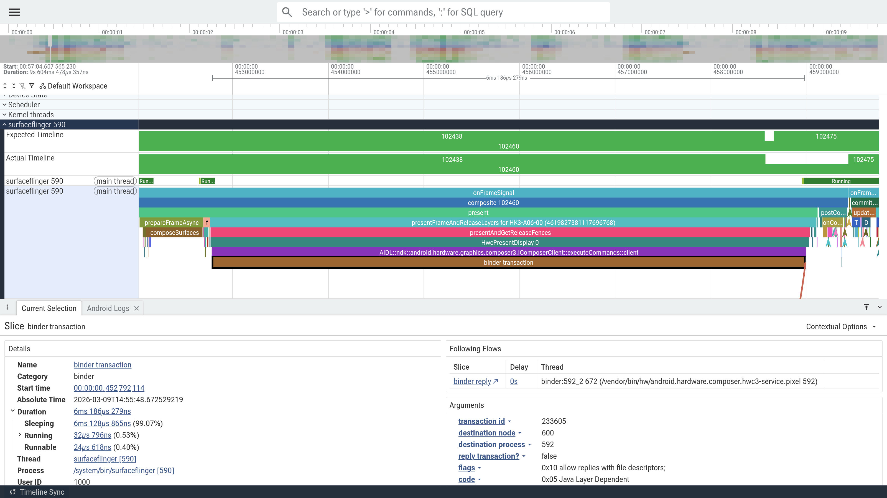
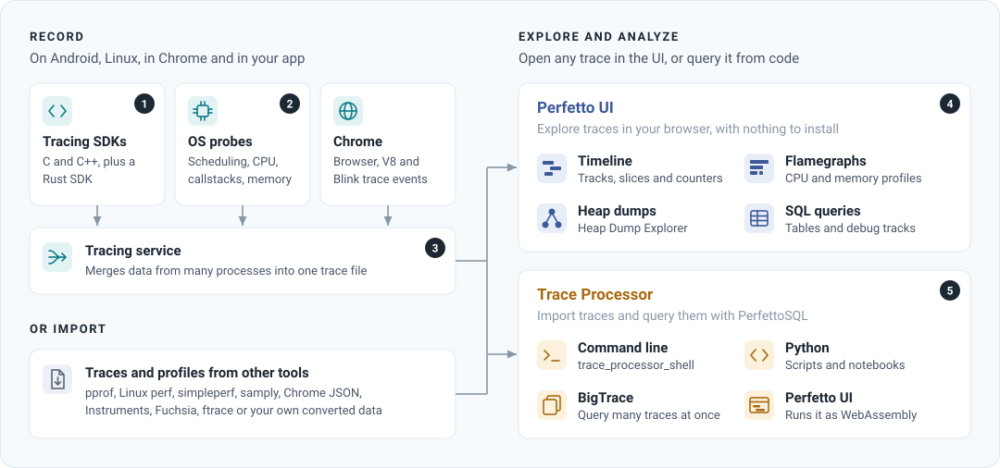

<div align="center">

<h1><a href="https://perfetto.dev">Perfetto</a></h1>

<p><strong>Record, explore and query traces of complex software.</strong></p>

<p>
  <a href="https://discord.gg/35ShE3A"></a>
  <a href="https://github.com/google/perfetto/releases/latest"></a>
  <a href="LICENSE"></a>
</p>

<p>
  <a href="https://ui.perfetto.dev/#!/?url=https%3A%2F%2Fstorage.googleapis.com%2Fperfetto-misc%2Fexample_android_trace">Try the demo</a> ·
  <a href="#quick-start">Quick start</a> ·
  <a href="#what-can-you-do-with-it">What can you do with it?</a> ·
  <a href="https://perfetto.dev/docs/">Documentation</a> ·
  <a href="https://discord.gg/35ShE3A">Discord</a>
</p>

</div>

## What is Perfetto?

Perfetto is an open-source suite of tools for **recording, visualizing and
analyzing traces**: timelines of what software and the system under it were
doing. It is the default tracing system for **Android** and **Chromium**.
System-wide recording works on Android and Linux. The tracing SDK, the UI and
Trace Processor also run on macOS and Windows.

- **Record the whole system.** Scheduling, CPU frequency, memory, syscalls and
  any kernel tracepoint on Android and Linux, plus Android framework events,
  callstack sampling and Java and native heap profiles.
- **Instrument your own code.** Add trace points with the
  [C++](https://perfetto.dev/docs/instrumentation/tracing-sdk) or
  [Rust](https://perfetto.dev/docs/getting-started/rust-sdk) SDKs and see them
  next to everything else.
- **Open traces from other tools.** Chrome JSON, Linux `perf`, Firefox
  Profiler, macOS Instruments, pprof, systrace, Fuchsia and
  [more](https://perfetto.dev/docs/getting-started/other-formats).
- **Explore multi-GB traces in the browser.** The
  [Perfetto UI](https://ui.perfetto.dev) needs no install and runs fully
  locally: traces are not uploaded anywhere.
- **Query everything with SQL.**
  [Trace Processor](https://perfetto.dev/docs/analysis/trace-processor) turns
  any trace into tables, with a standard library for common analyses. Use it
  from the command line, Python or C++.
- **Bring your AI agent.** The
  [Perfetto AI skill](https://perfetto.dev/docs/getting-started/using-ai)
  teaches coding agents to record and analyze traces.

## Try it in your browser

Open an [example Android trace](https://ui.perfetto.dev/#!/?url=https%3A%2F%2Fstorage.googleapis.com%2Fperfetto-misc%2Fexample_android_trace)
without installing anything, or drag your own trace file onto
[ui.perfetto.dev](https://ui.perfetto.dev).

[](https://ui.perfetto.dev/#!/?url=https%3A%2F%2Fstorage.googleapis.com%2Fperfetto-misc%2Fexample_android_trace)

## Quick start

### Record a trace

On **Android**, with a device connected over adb:

```bash
curl -O https://raw.githubusercontent.com/google/perfetto/main/tools/record_android_trace
python3 record_android_trace -o trace.pftrace -t 10s sched freq gfx view am wm
```

The trace opens in the Perfetto UI when recording finishes.

On **Linux**, record scheduling activity with `tracebox`:

```bash
curl -LO https://get.perfetto.dev/tracebox && chmod +x tracebox
curl -LO https://raw.githubusercontent.com/google/perfetto/main/test/configs/scheduling.cfg
sudo ./tracebox -o trace.pftrace --txt -c scheduling.cfg
```

For **Chrome**, use the [recording page](https://ui.perfetto.dev/#!/record)
in the UI. To trace **your own app**, see
[in-app tracing](https://perfetto.dev/docs/getting-started/in-app-tracing).

### Query it with SQL

```bash
curl -LO https://get.perfetto.dev/trace_processor && chmod +x trace_processor
./trace_processor query trace.pftrace \
  "SELECT name, COUNT(*) AS cnt FROM slice GROUP BY name ORDER BY cnt DESC LIMIT 10"
```

Or from Python:

```bash
pip install perfetto
```

```python
from perfetto.trace_processor import TraceProcessor

tp = TraceProcessor(trace='trace.pftrace')
print(tp.query('SELECT ts, dur, name FROM slice LIMIT 10').as_pandas_dataframe())
```

## What can you do with it?

- **Android app and platform developers:** root-cause slow startups, jank,
  ANRs and low memory kills, and profile Java/Kotlin and native memory.
  ([Android guides](https://perfetto.dev/docs/getting-started/android-trace-analysis))
- **C, C++ and Rust developers:** instrument your code to see where time goes
  across threads and processes.
  ([In-app tracing](https://perfetto.dev/docs/getting-started/in-app-tracing))
- **Linux kernel and systems developers:** visualize scheduling, syscalls,
  interrupts and custom tracepoints. Perfetto is an efficient userspace daemon
  for `ftrace`.
  ([Linux cookbook](https://perfetto.dev/docs/getting-started/linux-cookbook))
- **Chromium developers:** Perfetto is the tracing backend behind
  `chrome://tracing`, for debugging the browser, V8 and Blink.
  ([Chrome tracing](https://perfetto.dev/docs/getting-started/chrome-tracing))
- **Performance engineers:** analyze traces from many tools in one place and
  automate the analysis with SQL across thousands of traces.
  ([Trace analysis](https://perfetto.dev/docs/analysis/getting-started))

Not sure where to start? [How do I start using Perfetto?](https://perfetto.dev/docs/getting-started/start-using-perfetto)
picks a path based on what you want to do.

## How it fits together



Perfetto is a collection of components that work together:

- **Tracing daemons** (`traced`, `traced_probes`) collect data from many
  processes and the kernel into a single trace file.
- **The tracing SDK** writes your app's trace points with low overhead.
- **The Perfetto UI** visualizes traces on a timeline.
- **Trace Processor** parses traces into a SQL database for analysis.

See the [documentation](https://perfetto.dev/docs/) for the full picture.

## Community and support

- **[Discord](https://discord.gg/35ShE3A):** ask questions in #help, chat with
  the team and community, and follow releases.
- **[GitHub issues](https://github.com/google/perfetto/issues):** report bugs.
- **[Mailing list](https://groups.google.com/forum/#!forum/perfetto-dev):** if
  you prefer email.

See [Community and getting help](https://perfetto.dev/docs/community) for
more. We follow
[Google's Open Source Community Guidelines](https://opensource.google/conduct/).

## Contributing

Contributions are welcome. The
[contributor guide](https://perfetto.dev/docs/contributing/getting-started)
covers building, testing and sending pull requests.

## Packages

The Debian packaging of Perfetto is maintained in the
[Debian Perfetto Salsa repository](https://salsa.debian.org/debian/perfetto).

## License

Apache 2.0. See [LICENSE](LICENSE) for details.
