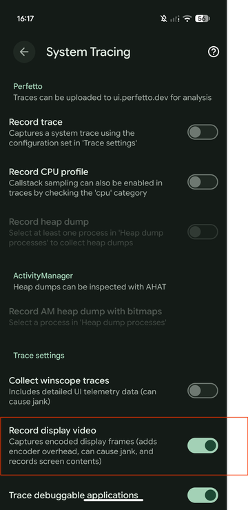
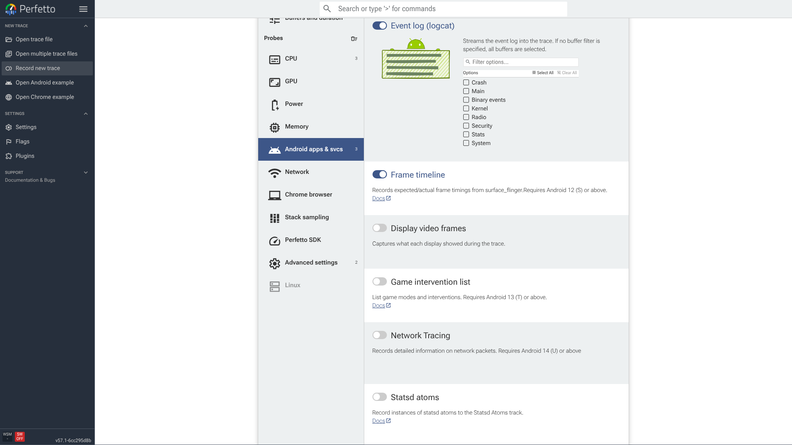
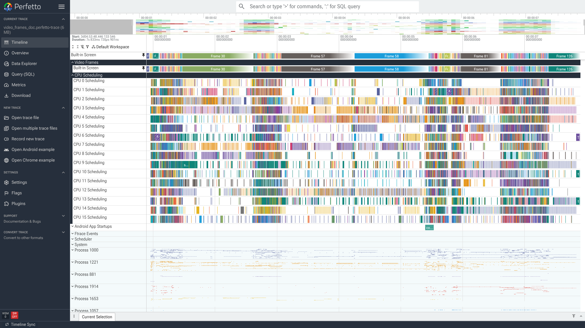
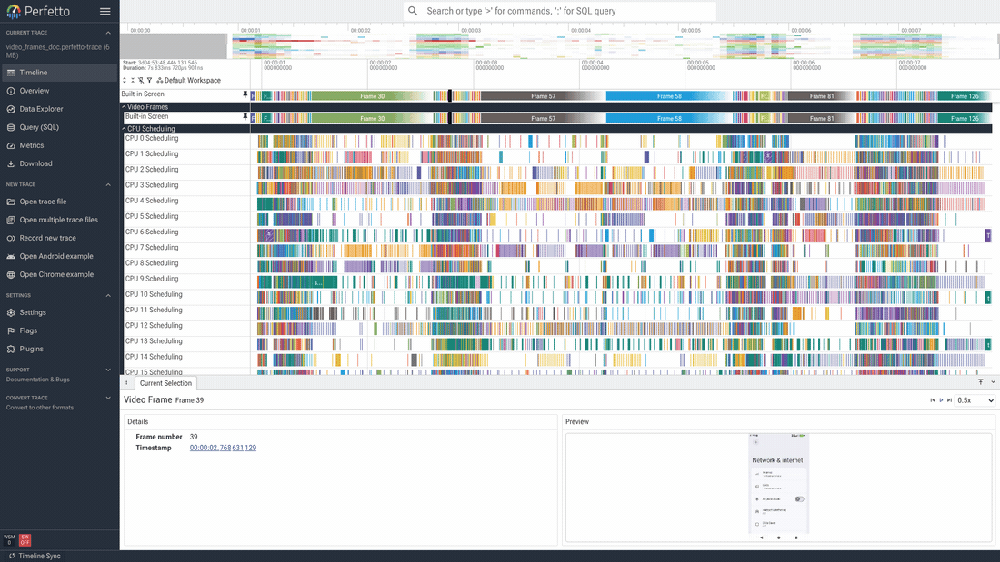

# Screen recording

The **android.display.video** data source records what each physical
display showed while a trace was being captured. Perfetto stores the
frames as an encoded video stream inside the trace, and the UI adds a
per-display timeline track that decodes them in the browser. You can
hover the track to preview a frame, play the frames back like a video,
and click any frame to line it up with the tracks below it.

It records the actual contents of the screen, so any trace that contains
it is sensitive: it shows exactly what was on the display. On `userdebug`
(debuggable) devices it is available out of the box. On `user`
(production) builds it is disabled by default and must be unlocked with a
system property first — see [Prerequisite on `user`
builds](#prerequisite-on-user-builds).

This guide covers:

- [How it works, and what it costs](#how-it-works-and-what-it-costs) —
  how the frames get into the trace, and the overhead on the device.
- [Capturing display video](#capturing-display-video): the property to
  set first on `user` builds, then the three ways to turn it on — the
  on-device toggle, the record page, and a raw config with full control
  over quality and size.
- [Viewing display video](#viewing-display-video): the timeline track,
  hovering to preview a frame, and playing the capture back with the
  timeline kept in sync.
- [Linking frames to the frame timeline](#linking-frames-to-the-frame-timeline):
  matching each captured frame to the SurfaceFlinger vsync that produced
  it.

## How it works, and what it costs

While the data source is enabled, the device encodes what each display
shows into a video stream stored in the trace — one frame each time the
screen changes — and the UI decodes it back in the browser. This has two
costs:

- **Encoder and CPU overhead.** Encoding frames uses the device's video
  encoder while the trace runs. On a busy display this adds load and can
  perturb the timing you are measuring.
- **Trace size.** The stream grows with resolution and with how much the
  screen changes; the `scale` and `max_stream_size_bytes` options below
  keep it bounded.

When the data source is off, it costs nothing.

## Capturing display video

There are three ways to turn on display-video capture, from the simplest
to the most control. On `user` builds there is also a one-time-per-boot
property to set first — see the prerequisite below.

### Prerequisite on `user` builds {#prerequisite-on-user-builds}

On `userdebug` (debuggable) devices, display-video capture works out of
the box, and you can skip this step. On `user` (production) builds it is
disabled by default: unlock it first by setting a system property over
ADB.

```
adb shell setprop debug.tracing_video_allowed true
```

This property is **not persistent** — it is cleared on the next reboot.
After the device restarts you have to set it again before you can capture
display video. Once it is set, capture works through any of the methods
below: the on-device toggle, the record page, or a raw config.

### On the device, with system tracing

The System Tracing app has a **Record display video** toggle under
**Trace settings**. Enable it, then record a trace as usual — the capture
is included automatically. This is the quickest route on a device you are
holding — no config to write.



### From the record page

Open the Perfetto UI record page, find **Display video frames** under the
Android probes, and enable it. This adds the `android.display.video` data
source to the generated config with the producer's default settings.



### From a raw trace config

For full control, write the config yourself. Enable
`android.display.video`, and add a `display_video_config` to set quality
and size. With no options, each display uses the device's default
settings:

```
data_sources {
  config {
    name: "android.display.video"
  }
}
```

Add a `display_video_config` to tune the capture. Every field is
optional; an unset or zero field uses the producer default.

```
data_sources {
  config {
    name: "android.display.video"
    display_video_config {
      scale: 0.5
      format: FORMAT_H264
      key_frame_interval_secs: 2
      bitrate_bps: 8000000  # 8 Mbps
      max_stream_size_bytes: 67108864  # 64 MiB per display
    }
  }
}
```

| Option | Description |
| --- | --- |
| `scale` | Factor applied to each display's resolution before capture, e.g. `0.5` for half size or `0.25` for quarter. Lower scale means less encoder load and a smaller trace, at the cost of detail. |
| `format` | `FORMAT_H264` (the default) or `FORMAT_HEVC`. HEVC produces a smaller stream at the same quality, but the device must support HEVC encoding to capture it and the browser must support HEVC decoding to preview it. |
| `key_frame_interval_secs` | How often a keyframe is emitted. Smaller values make seeking snappier but grow the trace; larger values are more compact but slower to scrub. |
| `bitrate_bps` | Target encoder bitrate, in bits per second. Trace size is roughly bitrate × duration, so this trades quality against size at a fixed resolution (unlike `scale`, which lowers the resolution). Left unset, the device picks a default. |
| `max_stream_size_bytes` | A per-display cap on emitted bytes. When a display hits it, its stream is torn down (a size-cap error) rather than growing without bound. Left unset, the device applies a default cap of 256 MiB per display. |

## Size limits

Display video is limited to 256 MiB per display, enforced in two separate
places:

- On the device, `max_stream_size_bytes` caps how much each stream emits
  (256 MiB by default; a size-cap error is recorded when it is hit).
- Independently, trace_processor drops any frames beyond 256 MiB per
  stream when it loads the trace, so raising the on-device cap alone will
  not get you more frames in the UI.

On a long session or at a high resolution, the video can therefore stop
before the end of the trace. Both limits exist because of the memory cost
of holding the stream, not a fundamental constraint. If they get in your
way, comment on and upvote the tracking issue so it can be prioritised:
[perfetto#6609](https://github.com/google/perfetto/issues/6609).

## Viewing display video

### The timeline track

A trace that contains display video shows a **Video Frames** group with
one track per display (for a phone, typically a single **Built-in
Screen**). Each slice on the track is one captured frame, labelled with a
frame number. That number is just a sequential counter of captured frames
— it has nothing to do with the vsync ids in the frame timeline. A frame
that is linked to the SurfaceFlinger composite that produced it is
labelled with that composite's vsync id instead (e.g. `vsync 123456`);
see [Linking frames to the frame
timeline](#linking-frames-to-the-frame-timeline).



### Hovering to preview a frame

Move the pointer along the track to preview frames. The frame under the
cursor is decoded and shown as a thumbnail above the row, so you can scrub
to find the frame you want.


### Playing back

Click a frame to open its details. The panel shows the frame number and
timestamp on the left and a decoded **Preview** on the right, with
playback controls in the header: previous frame, play/pause, next frame,
and a playback-speed selector. Press play and the capture runs as a
video: the preview advances through the frames and the timeline selection
moves with it, so the rest of the UI stays lined up with what is on
screen. Step one frame at a time with the previous/next buttons, or change
the speed selector to play back slower (down to 0.1×) or faster (up to
2×).



### Exporting to an .mp4 from the command line

`python/tools/trace_video_conv.py` pulls the captured video out of a trace
into an `.mp4` using ffmpeg's libav (the encoded frames are copied as-is, not
re-encoded). It needs the PyAV package (`pip install av`), plus `ffmpeg` on the
`PATH` for `--compare` and for clips with frameless gaps that need padding;
`trace_processor` is downloaded
automatically, or pass `--trace-processor` to use a local build.

```bash
# List the video streams in a trace.
python3 python/tools/trace_video_conv.py TRACE.perfetto-trace --list

# Convert the whole video to an .mp4.
python3 python/tools/trace_video_conv.py TRACE.perfetto-trace -o out.mp4

# Clip to a time range (trace ts, ns), or to whatever a query selects
# (the query returns a `ts` column, and optionally `dur`).
python3 python/tools/trace_video_conv.py TRACE.perfetto-trace -o clip.mp4 --start <ts> --end <ts>
python3 python/tools/trace_video_conv.py TRACE.perfetto-trace -o clip.mp4 \
    --query "SELECT ts, dur FROM slice WHERE name = 'my_cuj'"

# Slow motion (0.5x) or 2x faster.
python3 python/tools/trace_video_conv.py TRACE.perfetto-trace -o out.mp4 --speed 0.5

# Two traces side by side, each captioned (defaults to the file names).
python3 python/tools/trace_video_conv.py before.perfetto-trace --compare after.perfetto-trace \
    -o compare.mp4 --title Before --title2 After
```

| Option | Description |
| --- | --- |
| `-o, --output` | Output `.mp4` path. |
| `--list` | List the trace's video streams and exit. |
| `--display-id` | Which stream to use, for a trace with more than one display. |
| `--start`, `--end` | Clip to a time range, in trace `ts` nanoseconds. |
| `--query` | Clip to the region a SQL query selects (returns `ts`, optionally `dur`). |
| `--speed` | Playback speed of the output: `2` = twice as fast, `0.5` = slow motion. |
| `--compare` | A second trace, placed to the right for a side-by-side comparison. |
| `--display-id2` | Which stream to use from the `--compare` trace. |
| `--start2`, `--end2` | Clip the `--compare` trace to a time range. |
| `--query2` | Clip the `--compare` trace to a SQL-selected region. |
| `--title`, `--title2` | Captions for the first and second videos (default: the file names). |
| `--trace-processor` | Path to a local `trace_processor` build (otherwise one is downloaded). |

## Linking frames to the frame timeline

Each captured frame can be linked to the SurfaceFlinger composite that
produced it, and through it to that vsync's
[frame timeline](/docs/data-sources/frametimeline.md). The link comes from
SurfaceFlinger's **android.surfaceflinger.virtualdisplay** data source,
which emits one packet per composite queued to a virtual display, with the
composite's vsync id and the present time stamped on the queued buffer.
The encoder normally carries that present time through as the frame's
presentation time, so trace_processor matches the two and stores the vsync
id in the `frame_timeline_vsync_id` column of `__intrinsic_video_frames`.

Enable it next to the capture, together with the frame timeline that the
links point to:

```
data_sources {
  config {
    name: "android.display.video"
  }
}
data_sources {
  config {
    name: "android.surfaceflinger.virtualdisplay"
  }
}
data_sources {
  config {
    name: "android.surfaceflinger.frametimeline"
  }
}
```

The virtual display data source is only available on devices whose
SurfaceFlinger has the
`com.android.graphics.surfaceflinger.flags.virtual_display_composite_tracing`
flag enabled. Without it, frames are captured as usual but stay unlinked.

In the UI, linked frames are labelled with their vsync id on the video
track. The video frame's details show the **Frame timeline vsync id**,
which links to the SurfaceFlinger DisplayFrame on the frame timeline, and
list the app frames composited into it, each linking to that app's frame.
In the other direction, selecting a slice on an **Actual Timeline** track
shows a **Display video** section with a **Jump to video frame** link when
that vsync produced a captured frame.

A frame stays unlinked when no composite has its presentation time, for
example because the encoder adjusted the timestamps, or when composites
with different vsync ids share it. The
`android_video_vsync_composite_unmatched` stat counts composites with no
matching video frame, and `android_video_vsync_present_time_ambiguous`
counts present times that map to conflicting vsync ids and matched a
frame. The display id in the composite packets is SurfaceFlinger's id for
the virtual display, which is unrelated to the video stream's display id,
so the present time is the only key the match can use.
