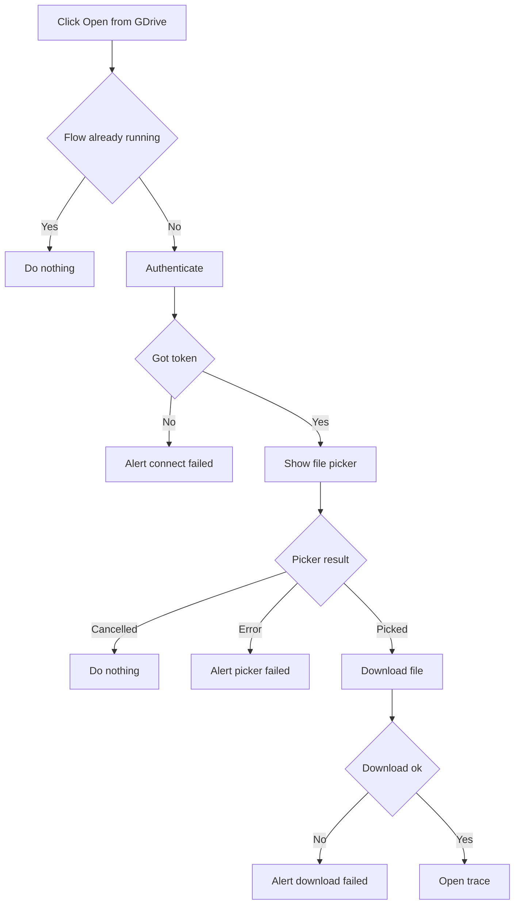
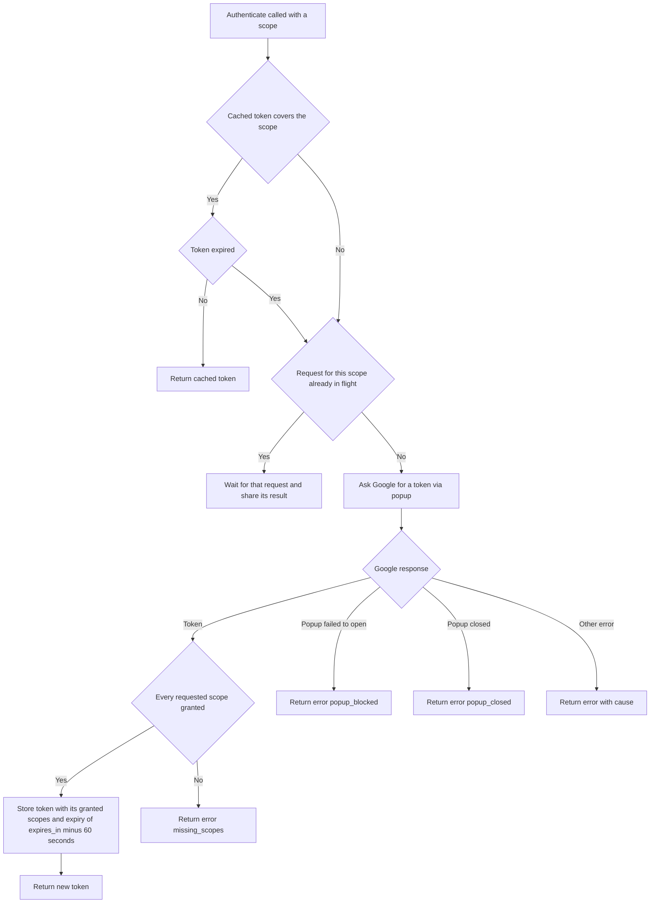

# dev.perfetto.GoogleDrive

Opens traces from Google Drive through the "Open from GDrive" sidebar button
(file picker). The "Install Google Drive support" command connects Perfetto to
a Google account, which adds it to Drive's "Open with" menu.

## Flows

### Sidebar flow (openFileFromSidebar)



### Authenticate step (GoogleOAuthClient authenticate)

Every "Authenticate" box above runs this. It never throws: every outcome is
returned as a Result.



### Scopes

Each action passes the OAuth scope it needs to `authenticate()`, one at a
time. There is no default:

| Scope | What it allows | Asked for by |
| --- | --- | --- |
| `drive.install` | Perfetto is offered in Drive's "Open with" menu. No access to files | The "Install Google Drive support" command |
| `drive.file` | Reading and creating the files the user opens or picks with Perfetto | Nothing yet: the flows that open files will ask for it |

Asking for one scope at a time matters. When an app asks for several together,
Google's consent screen shows a tick box for each and the user can refuse any
of them, and there is no way to mark one as required. A single scope is simply
allowed or cancelled. The client still checks which scopes were granted, and
returns `missing_scopes` if any that were asked for are missing.

## Content Security Policy

The UI's Content Security Policy (CSP) is set in
`setupContentSecurityPolicy()` in `ui/src/frontend/index.ts`. This plugin is
the reason for the entries below. They apply to every user of the UI, whether
or not they use Google Drive, so keep them as narrow as the plugin allows.

| Directive | Entry | Why it is needed |
| --- | --- | --- |
| `script-src` | `https://accounts.google.com/gsi/client` | Google Identity Services, which issues the access token |
| `script-src` | `https://apis.google.com/js/api.js` | The Google API loader |
| `script-src` | `https://apis.google.com/_/scs/abc-static/_/js/` | The modules the loader fetches (the picker) |
| `frame-src` | `https://docs.google.com/picker` and `/picker/` | The picker dialog |
| `img-src` | `https://ssl.gstatic.com` | Icons used by the picker |

Why the entries look the way they do:

- **Google's scripts cannot be bundled.** They are only served by Google and
  change without notice, so they are loaded at runtime and need `script-src`
  entries. The module URLs contain version hashes, so only their directory
  can be named.
- **Paths, not hosts.** `*.google.com` was removed from `script-src` in #8176
  because those hosts serve many other scripts. Each entry here names one
  script, or one directory, instead.
- **No frame entry for connecting.** The plugin only uses the OAuth token
  client, which opens a popup. Popups are not governed by `frame-src`, so
  `accounts.google.com` is not listed there.
- **Drive requests need nothing extra.** They are plain `fetch()` calls to
  `www.googleapis.com`, which `connect-src` already allows.

### Known limits

The path-based entries narrow the policy but are not a hard boundary. All of
the following need an HTML injection bug in the UI before they matter, and
none is known to allow arbitrary script execution.

- **Query strings are ignored by CSP.** `api.js` accepts an `onload`
  parameter naming a global function to call once it has loaded. Injected
  markup could use that to call a top-level global function, without
  arguments. In production the service worker blocks external requests that
  have a query string, which stops this once the worker controls the page.
  That is not the case on localhost or on a first visit.
- **Paths are not checked after a redirect.** Once a request is redirected,
  CSP only matches the host. A redirect that starts inside the module
  directory and stays on `apis.google.com` is therefore allowed, so in
  practice treat the whole of `apis.google.com` as allowed for scripts.
- **Every loader module is reachable,** not only the one the plugin uses, and
  Google Identity Services can be driven from page markup (an element with
  the id `g_id_onload`). Both could be used to call a global function by
  name, or to show a Google sign-in prompt on this origin.

Moving `script-src` to hashes or nonces with `'strict-dynamic'` would remove
this whole class, as injected `<script>` tags would no longer run whichever
host they point at. That is a larger change to how the UI is served and has
not been done.

### When changing these entries

Run the flows under [No CSP violations](#no-csp-violations), and get the
change reviewed by someone on the security side.

## Manual testing

Keep this list up to date when adding a flow or a failure mode.

### What to test

Each of these links to a section below. When testing a change, copy this list
into the PR description as a checklist rather than ticking it off here.

Happy paths:

- [Install Google Drive support](#install-google-drive-support)
- [Sidebar flow](#sidebar-flow)
- [Token reuse within a session](#token-reuse-within-a-session)
- ["Open with" deep link](#open-with-deep-link)
- [Resource key](#resource-key)
- [Drive traces are not shareable](#drive-traces-are-not-shareable)

Button state:

- [Button state](#button-state)
- [Initialisation fails](#initialisation-fails)
- [Plugin disabled](#plugin-disabled)

Failure modes:

- [Popup blocked](#popup-blocked-connect-to-google-drive-dialog)
- [Connection failure](#connection-failure-couldnt-connect-to-google-drive-dialog)
- [Google popup closed](#google-popup-closed)
- [File not yet authorised](#file-not-yet-authorised-authorize-access-to-file-dialog)
- [Initialisation fails, with a deep link](#initialisation-fails)
- [Invalid deep link payload](#invalid-deep-link-payload)
- [Download failures](#download-failures)
- [Picker failures](#picker-failures)

Content Security Policy:

- [No CSP violations](#no-csp-violations)

### Setup

1. Run `ui/run-dev-server` and open `http://localhost:10000`.
2. The plugin is not enabled by default. Open
   `http://localhost:10000/#!/plugins`, enable `dev.perfetto.GoogleDrive` and
   reload.
3. `http://localhost:10000` must be an authorised JavaScript origin on the
   OAuth client named in the config. If the picker works locally, it is.
4. The access token is only kept in memory, so every page load starts
   disconnected.
5. Everything Google Drive support needs is loaded once, on every page load:
   the config and Google's scripts. See
   [Initialisation fails](#initialisation-fails).

Every "I give up" dialog (connection, picker and download failures) has an
"OK" button only, and no retry. Where there is an underlying error, it is
shown in a collapsed "Error details" section of the dialog rather than logged
to the console.

Two DevTools techniques are used below:

- **Block a request:** in the Network tab, right-click a request and choose
  "Block request URL" (or add a pattern in the "Network request blocking"
  drawer tab), then reload.
- **Build a deep link:** see ["Open with" deep link](#open-with-deep-link).

### Install Google Drive support

The "Install Google Drive support" command asks for permission to add
Perfetto to the "Open with" menu in the user's Google Drive. It does not ask
for access to any files.

1. Open the command palette (Ctrl/Cmd+Shift+P) and run "Install Google Drive
   support".
2. Complete the Google popup. It should ask only for permission to connect
   Perfetto to Google Drive, with no tick boxes and no mention of files. A
   "Google Drive support installed" dialog should appear.
3. Run the command again without reloading: the dialog should appear straight
   away, with no Google popup.
4. Close the Google popup instead of completing it: the "Couldn't connect to
   Google Drive" dialog should appear, see
   [Google popup closed](#google-popup-closed).
5. With initialisation failing (see
   [Initialisation fails](#initialisation-fails)), the command should show the
   "Google Drive unavailable" dialog.

### Sidebar flow

1. Click "Open from GDrive" in the sidebar.
2. Complete the Google popup if it asks.
3. Pick a trace in the picker. It should open, titled with the file's name.
4. Cancel the picker instead of picking: nothing should happen.
5. Clicking the button again while a flow is still running (e.g. while the
   picker is open) should do nothing.

### Token reuse within a session

1. Complete the sidebar flow once.
2. Without reloading, click "Open from GDrive" again.
3. The picker should open straight away, with no Google popup.

The token is reused until about a minute before it expires (normally an hour).
After that, or after a page reload, the Google popup is needed again.

### "Open with" deep link

Drive opens the UI with a `state` query parameter naming the file. To
reproduce that without going through Drive, paste a URL like this into the
address bar of a new tab:

```
http://localhost:10000/?state=%7B%22ids%22%3A%5B%22<FILE_ID>%22%5D%2C%22action%22%3A%22open%22%7D
```

That is `{"ids":["<FILE_ID>"],"action":"open"}` URL-encoded. Take `<FILE_ID>`
from a Drive link (`https://drive.google.com/file/d/<FILE_ID>/view`).

Expected:

1. Unless popups are allowed for the site, the "Connect to Google Drive"
   dialog appears first, see
   [Popup blocked](#popup-blocked-connect-to-google-drive-dialog).
2. Once connected, the trace loads, titled with the file's real name. The
   deep link only carries the file ID, so the name is looked up from Drive
   with a separate metadata request, in parallel with the download.
3. The `state` parameter is removed from the address bar once connected. It
   stays if the user cancels the "Connect to Google Drive" dialog or
   connecting fails, so reloading retries the deep link.

If the name lookup fails the trace should still open, titled "Google Drive
file", and a warning is logged to the console. To check, block
`*fields=name*` in DevTools and load the deep link again.

#### From a real "Open with" click

The app is registered with Google Drive as an "Open with" app, so the real
flow can be tested too:

1. Connect through the UI at least once (e.g. with the sidebar flow).
   Granting access is what adds Perfetto to your Drive's "Open with" menu.
2. In Drive, right-click a trace, choose "Open with" and pick Perfetto. Drive
   opens the registered URL with a `state` parameter for that file.
3. To land on a local build instead of the registered URL, use a redirect
   extension (e.g. Requestly) to rewrite the registered URL to
   `http://localhost:10000/`, keeping the query string.

A file opened this way should already be authorised, so it should load without
the "Authorize access to file" dialog.

### Resource key

Some link-shared files need a resource key as well as the file ID. Their links
look like `.../file/d/<FILE_ID>/view?resourcekey=<KEY>`. To test one, use a
file you do not own and have not opened before, and add the key to the state
payload:

```json
{"ids":["<FILE_ID>"],"action":"open","resourceKeys":{"<FILE_ID>":"<KEY>"}}
```

URL-encode it and load it as the `state` parameter. In the DevTools Network
tab, the Drive download and metadata requests should carry the header
`X-Goog-Drive-Resource-Keys: <FILE_ID>/<KEY>`.

### Drive traces are not shareable

Drive traces are access-controlled, so they must not be uploaded to the public
permalink bucket.

1. Open a trace from Drive by either route.
2. The UI should not offer to share it or create a permalink for it.

### Button state

The plugin is not enabled by default for anyone. Once it is enabled, the
"Open from GDrive" button is shown to every user, just below "Open trace
file". It is disabled (struck through) until initialisation has succeeded:
the config and Google's scripts all loaded. That happens shortly after
startup. Clicking the button while it is disabled says why.

To test, enable the plugin and reload:

1. For a moment after the page loads the button may be disabled. Clicking it
   then should say that Google Drive support is still loading.
2. Once initialisation finishes the button should be enabled.

### Initialisation fails

On every page load the plugin loads, in order:

1. the config (API key, client ID and app ID), from
   `https://storage.googleapis.com/perfetto-misc/gdrive_config.json`,
2. Google's sign-in library, from `https://accounts.google.com/gsi/client`,
3. Google's API loader script, from `https://apis.google.com/js/api.js`,
4. the picker module, also from `apis.google.com`.

None of this opens a popup. If any step fails, "Failed to initialize Google
Drive" is logged to the console (with the failing step as its cause) and the
sidebar buttons stay disabled. Nothing else is shown: no error dialog, as
this runs for every user on every load.

For each of the URLs above in turn:

1. Block it and reload.
2. The "Open from GDrive" button should stay disabled, and clicking it
   should say that Google Drive support could not be loaded. The console
   should show "Failed to initialize Google Drive".
3. Load a deep link URL with the request still blocked. A "Google Drive
   unavailable" dialog should appear, and the `state` parameter should stay in
   the address bar.
4. Unblock the URL and reload the same deep link. It should now proceed.

Also check that with everything blocked the rest of the UI works normally,
e.g. opening a local trace.

The config fetch times out after 5 seconds, and each of the other steps after
30 seconds. Until initialisation finishes, a deep link shows nothing. A failed
initialisation is not retried until the page is reloaded.

### Plugin disabled

The plugin is not enabled by default, so this is the state on a fresh profile.

1. Open `http://localhost:10000/#!/plugins`, make sure
   `dev.perfetto.GoogleDrive` is disabled, then reload.
2. The "Open from GDrive" button should not appear.
3. In the DevTools Network tab there should be no requests for the config or
   for Google's scripts (see [Initialisation fails](#initialisation-fails) for
   the URLs).
4. Loading a deep link URL should do nothing.
5. Re-enable the plugin afterwards.

### Popup blocked ("Connect to Google Drive" dialog)

This only happens on a deep link: the sidebar flow starts from a click, so the
browser allows the popup.

1. Make sure popups are not set to "Allow" for `localhost:10000`
   (`chrome://settings/content/popups`).
2. Load the deep link URL and do not click anything while it loads.
3. The "Connect to Google Drive" dialog should appear, including a hint that
   allowing pop-ups for the site skips this step.
4. Click "Connect". The Google popup should open, and once it completes the
   trace should load without a page reload.
5. Repeat and click "Cancel" instead. The dialog should close and nothing else
   should happen.
6. Set popups to "Allow" for `localhost:10000` and load the deep link again.
   The dialog should not appear; the Google popup should open by itself.

After "Connect" the popup is opened shortly after the click rather than inside
it, which Chrome allows. Other browsers may block it again, in which case the
"Couldn't connect to Google Drive" dialog appears saying the popup was
blocked.

### Connection failure ("Couldn't connect to Google Drive" dialog)

This is shown when Google reports an error while connecting, for example
because the user refuses to grant access.

1. Use a Google account that has not yet granted Perfetto access to Drive (or
   remove Perfetto's access from the account's third-party access page first).
2. Click "Open from GDrive", or load the deep link URL.
3. On Google's consent screen, press "Cancel" rather than granting access.
4. The "Couldn't connect to Google Drive" dialog should appear with Google's
   error, and the same error under "Error details", rather than the generic
   crash dialog.
5. "OK" dismisses it and ends the flow. Start again from the sidebar button or
   by reloading the deep link.

### Google popup closed

1. Set popups to "Allow" for `localhost:10000`, or start from the sidebar
   button.
2. When the Google popup opens, close it without completing it.
3. The "Couldn't connect to Google Drive" dialog should appear, saying the
   window was closed. There is no "Error details" section for this case.
4. "OK" dismisses it and ends the flow. Clicking the sidebar button again
   should reopen the popup; reloading a deep link should retry it.

### File not yet authorised ("Authorize access to file" dialog)

The app can only read files the user has opened or picked with it.

1. Set popups to "Allow" for `localhost:10000`.
2. Load the deep link URL with the ID of a file that has never been opened or
   picked through this app.
3. The download should fail with HTTP 403 or 404 and the "Authorize access to
   file" dialog should appear.
4. Click "Authorize File Access". The dialog closes and the picker opens,
   showing only that file. Pick it, and the trace should open, titled with the
   file's real name.
5. Repeat and click "Cancel" in the dialog, or cancel the picker: the flow
   should end silently.

Drive reports a file the app has not been granted as "not found", the same as
a file that does not exist. So a deep link with a made-up file ID also shows
this dialog; the picker it opens will then have nothing to pick.

### Invalid deep link payload

Each of these should be ignored silently: no dialog, no Google popup, and the
`state` parameter left in the address bar.

- `?state=not-json`
- `?state=%7B%22ids%22%3A%22abc%22%7D` (`ids` is not an array)
- `?state=%7B%22ids%22%3A%5B%5D%7D` (no file ID)
- A file ID or resource key containing anything other than letters, digits,
  `_` and `-`, e.g. `{"ids":["../x"]}`.

This assumes initialisation succeeded. The payload is only parsed after the
clients have loaded, so if initialisation fails any `state` parameter, valid
or not, shows the "Google Drive unavailable" dialog.

### Download failures

The easiest way to make only the download fail is to block
`*googleapis.com/drive/v3/files/*alt=media*` in DevTools: connecting, the
picker and the name lookup still work.

A failed download shows a "Couldn't open <file name> from Google Drive" dialog
(or "Couldn't open file from Google Drive" if the name is not known), with the
underlying error under "Error details".

The one exception is when Drive refuses access to the file (HTTP 403 or 404)
on a deep link: that shows the "Authorize access to file" dialog instead, see
[File not yet authorised](#file-not-yet-authorised-authorize-access-to-file-dialog).
On the sidebar flow a 403 or 404 is just a failed download.

- **Sidebar flow** (block the pattern, then pick a file): the failure dialog
  should appear.
- **Deep link, for an already authorised file** (block the pattern, then load
  the deep link): the failure dialog should appear, titled with the file's
  name, not the "Authorize access to file" dialog.
- **Deep link, the download after authorising fails** (load a deep link for a
  file not yet authorised, click "Authorize File Access", and block the
  pattern while the picker is showing, before picking the file): the failure
  dialog should appear.

### Picker failures

Cancelling or closing the picker is not a failure: from the sidebar nothing
happens, and on a deep link the flow ends silently.

If the picker cannot be built or reports an error, a "Couldn't open the Google
Drive file picker" dialog should appear, with the error under "Error details".

The picker's code is loaded during initialisation, so blocking requests
afterwards does not trigger this. To simulate it, run this in the DevTools
console after the page has loaded, then click "Open from GDrive":

```js
google.picker.PickerBuilder = class {
  constructor() {
    throw new Error('Simulated picker failure');
  }
};
```

### No CSP violations

The Google dialogs are only allowed by specific Content Security Policy
entries, see [Content Security Policy](#content-security-policy). If one is
missing the dialog does not appear, or appears blank, and the browser logs
the reason.

1. Open DevTools and keep the Console visible. Reload the page.
2. Run each of these, and check that the dialog renders fully, icons
   included:
   - the [Sidebar flow](#sidebar-flow), through the Google popup and the
     picker;
   - the ["Open with" deep link](#open-with-deep-link), including the
     "Authorize access to file" picker.
3. The console should show no message starting "Refused to" (for example
   "Refused to frame ..." or "Refused to load the script ...") that mentions
   a Google host.
