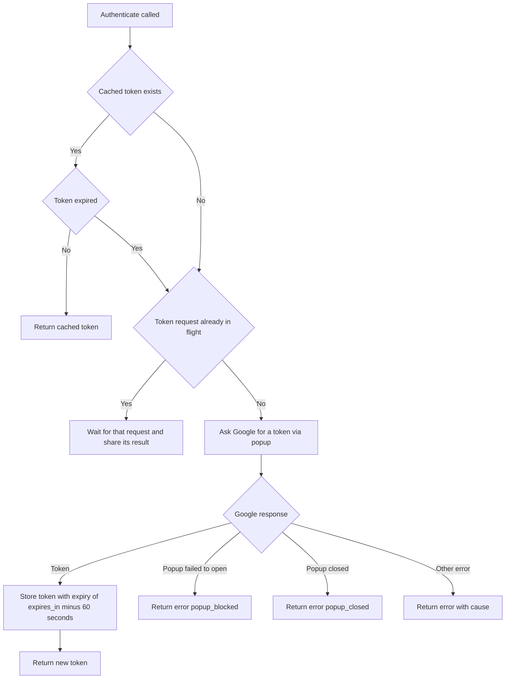

# dev.perfetto.GoogleDrive

Connects Perfetto to a Google account, as the first step towards opening
traces from Google Drive. For now it only adds one command, "Install Google
Drive support", which asks the user to grant Perfetto access. Granting access
also adds Perfetto to the "Open with" menu in the user's Google Drive, but
nothing handles opening a file from there yet.

The plugin is not enabled by default.

## Flows

### Authenticate step (GoogleOAuthClient authenticate)

The command runs this. It never throws: every outcome is
returned as a Result.

## Content Security Policy

The UI's Content Security Policy (CSP) is set in
`setupContentSecurityPolicy()` in `ui/src/frontend/index.ts`. This plugin is
the reason for the entry below. It applies to every user of the UI, whether or
not they use Google Drive, so keep it as narrow as the plugin allows.

| Directive | Entry | Why it is needed |
| --- | --- | --- |
| `script-src` | `https://accounts.google.com/gsi/client` | Google Identity Services, which issues the access token |

- **Google's script cannot be bundled.** It is only served by Google and
  changes without notice, so it is loaded at runtime and needs a `script-src`
  entry.
- **A path, not a host.** `*.google.com` was removed from `script-src` in
  #8176 because those hosts serve many other scripts. The entry names the one
  script instead.
- **No frame entry for connecting.** The plugin only uses the OAuth token
  client, which opens a popup. Popups are not governed by `frame-src`.

### Known limits

The path-based entry narrows the policy but is not a hard boundary. The
following needs an HTML injection bug in the UI before it matters, and is not
known to allow arbitrary script execution.

- **Google Identity Services can be driven from page markup** (an element
  with the id `g_id_onload`). Injected markup could use that to call a global
  function by name, or to show a Google sign-in prompt on this origin.

Moving `script-src` to hashes or nonces with `'strict-dynamic'` would remove
this class, as injected `<script>` tags would no longer run whichever host
they point at. That is a larger change to how the UI is served and has not
been done.

## Manual testing

There are no automated tests for connecting to Google, so it needs checking by
hand.

### Setup

1. Run `ui/run-dev-server` and open `http://localhost:10000`.
2. The plugin is not enabled by default. Open
   `http://localhost:10000/#!/plugins`, enable `dev.perfetto.GoogleDrive` and
   reload.
3. `http://localhost:10000` must be an authorised JavaScript origin on the
   OAuth client named in the config.
4. The access token is only kept in memory, so every page load starts
   disconnected.

### Install Google Drive support

The "Install Google Drive support" command connects Perfetto to a Google
account without opening anything. Granting access is what adds Perfetto to
that account's "Open with" menu in Google Drive.

1. Open the command palette (Ctrl/Cmd+Shift+P) and run "Install Google Drive
   support".
2. Complete the Google popup. A "Google Drive support installed" dialog should
   appear.
3. Run the command again without reloading: the dialog should appear straight
   away, with no Google popup.
4. Reload, run the command and close the Google popup instead of completing
   it: a "Couldn't connect to Google Drive" dialog should appear, saying the
   window was closed.
5. Reload, run the command and press "Cancel" on Google's consent screen (with
   an account that has not granted access yet): the same dialog should appear
   with Google's error, and the same error under "Error details".

### Initialisation fails

On every page load the plugin loads, in order:

1. the config (API key, client ID and app ID), from
   `https://storage.googleapis.com/perfetto-misc/gdrive_config.json`,
2. Google's sign-in library, from `https://accounts.google.com/gsi/client`.

None of this opens a popup. If either step fails, "Failed to initialize Google
Drive" is logged to the console (with the failing step as its cause) and
nothing else is shown.

For each of the URLs above in turn, block it in DevTools, reload, and run the
command. A "Google Drive unavailable" dialog should appear. The rest of the UI
should work normally.

### Plugin disabled

With the plugin disabled (the default), the command should not be listed, and
the DevTools Network tab should show no requests for the config or for
Google's script.
