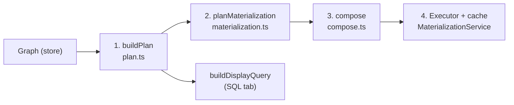
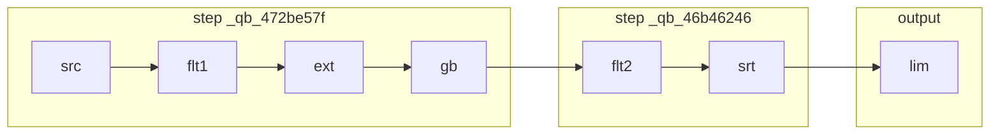

# How Spaghetti materialization works

This doc follows one graph through every stage of the pipeline. All plans, hashes and SQL below are **real output from the current code**, not hand-written examples.



| Stage | Pure? | Input | Output |
|---|---|---|---|
| Node generators | yes | config + input references | SQL / PSN fragment |
| 1. `buildPlan` | yes | graph + target node | `Plan`: nodes in topological order with Merkle hashes |
| 2. `planMaterialization` | yes | `Plan` | steps (one cache table each) + the output query |
| 3. `compose` (`formatStep`, `formatOutput`) | yes | a step or the output + dialect | one SQL string |
| 4. Executor | **no** | materialization plan + cache | tables in TraceProcessor, DataGrid source |

Every stage before the executor is a pure function of the graph, the target and the dialect. The cache only affects **which steps run**, never the plan.

---

## The example graph

A single docked chain, with the **Limit** node selected:

```
From(slice)
  → Filter(dur > 1000)
  → Extend(dur / 1e6 AS dur_ms)
  → GroupBy(name; COUNT(*) AS cnt, SUM(dur_ms) AS total_ms)   ← expensive
  → Filter(cnt > 5)
  → Sort(total_ms DESC)                                        ← expensive
  → Limit(10)                                                  ← selected
```

Node ids: `src`, `flt1`, `ext`, `gb`, `flt2`, `srt`, `lim`.

---

## 0. Node generators

Each node manifest has `generators: {sql, psn?}`, plus an optional `expensive: true`. Generators are pure. They receive the node's config and a context giving access to the inputs (`ctx.input(port)`, `ctx.inputs()`) and their columns.

**SQL fragments are structured clauses**, never full SQL strings to be parsed:

```ts
filter:  {where: 'dur > 1000'}
extend:  {select: ['*', 'dur / 1e6 AS dur_ms']}
groupby: {groupBy: ['name'], select: ['name', 'COUNT(*) AS cnt', 'SUM(dur_ms) AS total_ms']}
sort:    {orderBy: ['total_ms DESC']}
limit:   {limit: 10}
from:    {from: 'slice'}                       // a bare name: a plain reference
ii:      {from: '_interval_intersect!((a, b), (utid))', includes: [...]}
union:   {from: '(SELECT * FROM a UNION ALL SELECT * FROM b)'}
```

**PSN fragments are a source and/or stages:**

```ts
filter:  {stages: ['WHERE dur > 1000']}
from:    {source: 'FROM slice'}
ii:      {source: 'INTERVAL INTERSECTION OF (...)', stages: ['SELECT ...']}
```

A generator may also return:
- **`undefined`**: the node is incomplete, e.g. a required input isn't connected.
- **`{error}`**: the node can't be expressed in this dialect.
- **`{}`**: an empty fragment, meaning a passthrough.

Generators are called **twice** per node. The first call is during planning, with each input's *hash* as its reference, to compute hashes. The second is during composition, with *real* references (CTE names, `_qb_*` tables, inline pipelines). Because they're pure, both calls describe the same thing.

---

## 1. Graph → Plan (`plan.ts`)

`buildPlan(index, targetId)` walks **upstream** from the target depth-first, memoized per node, with cycle detection. For each node it:

1. Evaluates the node's inputs first, recursively.
2. Calls `generators.sql(config, ctx)` with **each input referred to by its hash**, so the fragment never contains a node id.
3. Handles the result:
   - `undefined`: incomplete, so the target gets no plan, which the UI shows as "Incomplete query".
   - `{}` (passthrough): the node takes its primary input's hash and drops out of the plan.
   - `{error}`: the PSN fragment is hashed instead.
4. Computes its **Merkle hash**:

```ts
hash = `_qb_${fnv(JSON.stringify({type, inputs: [[port, inputHash], ...], sql: fragment}))}`
```

The explicit `inputs` field is the Merkle link. A clause fragment like `{where: 'dur > 1000'}` never mentions its primary input, so without that field two identical filters on different tables would hash the same.

**The resulting plan for `lim`:**

```
  src   from     expensive=false refCount=1 inputs=[]     hash=_qb_42adaf5a
  flt1  filter   expensive=false refCount=1 inputs=[src]  hash=_qb_9045604c
  ext   extend   expensive=false refCount=1 inputs=[flt1] hash=_qb_61988b68
  gb    groupby  expensive=true  refCount=1 inputs=[ext]  hash=_qb_472be57f
  flt2  filter   expensive=false refCount=1 inputs=[gb]   hash=_qb_adc9c72c
  srt   sort     expensive=true  refCount=1 inputs=[flt2] hash=_qb_46b46246
  lim   limit    expensive=false refCount=0 inputs=[srt]  hash=_qb_3da59340
```

Properties of these hashes:
- **Identical subgraphs get identical hashes,** whatever their node ids or layout, and so share a cache table.
- **A node's hash changes exactly when its own config or anything upstream of it changes** (see the edit scenarios below).
- **The hash doesn't depend on the dialect.** The same node uses the same table in Standard SQL and PSN mode.

---

## 2. Plan → MaterializationPlan (`materialization.ts`)

**There is one rule:** the output of every `expensive` node becomes a cache table. A **step** is an expensive node plus the cheap nodes behind it, back to the previous expensive nodes, which become its `deps`. Whatever is left in front of the target is the **output**.

```
  step _qb_472be57f root=gb  nodes=[src,flt1,ext,gb] deps=[]
  step _qb_46b46246 root=srt nodes=[flt2,srt]        deps=[_qb_472be57f]
  output            root=lim nodes=[lim]             deps=[_qb_46b46246]
```



Steps are listed in dependency order, so each step comes after the steps it reads. Two identical subgraphs with the same hash share one step, and its `nodeIds` lists both sets of nodes.

The plan never looks at the cache: the same graph always gives the same steps.

---

## 3. Compose (`compose.ts`)

`formatStep(matPlan, step, dialect)` renders one step as a query body; the executor adds the `CREATE PERFETTO TABLE` itself. `formatOutput(matPlan)` renders the output, **always in Standard SQL**, because the DataGrid wraps it in plain SQL, which can't contain a pipe query. Nodes outside the step being rendered are referred to by table name: `_qb_<hash>`, or a temp name supplied by `graph_check`/`node_eval`.

### Standard SQL: clause-order folding

Each clause has a fixed position in SQL's evaluation order:

```
FROM(0) → WHERE(1) → GROUP BY(2) → SELECT(3) → DISTINCT(4) → ORDER BY(5) → LIMIT/OFFSET(6)
```

A node's fragment **folds** into its primary input's open block only if all of these hold:
- the input is in the same step and used once (`refCount === 1`);
- the fragment has no `from`;
- every clause it adds comes **strictly later** than the block's latest clause. The one exception is `WHERE` + `WHERE`, which is ANDed while the block hasn't got past `WHERE`.

Otherwise the input block is written out as a **CTE** named after its node type (`filter_1`, `extend_1`…), and a new block reads from it.

Step `_qb_472be57f`:

| Node | Fragment adds | Block's latest clause | Result |
|---|---|---|---|
| src | `from: slice` | n/a | block `{from: slice}` (bare relation) |
| flt1 | WHERE(1) | FROM(0) | folds |
| ext | SELECT(3) | WHERE(1) | folds |
| gb | GROUP BY(2) + SELECT(3) | SELECT(3) | **no fold**: `ext` becomes CTE `extend_1` |

```sql
WITH
extend_1 AS (
  SELECT
    *,
    dur / 1e6 AS dur_ms
  FROM slice
  WHERE dur > 1000
)
SELECT
  name,
  COUNT(*) AS cnt,
  SUM(dur_ms) AS total_ms
FROM extend_1
GROUP BY name
```

Step `_qb_46b46246`: `gb` is outside the step, so it's read from its table, and filter and sort fold together:

```sql
SELECT *
FROM _qb_472be57f
WHERE cnt > 5
ORDER BY total_ms DESC
```

Output: always Standard SQL; the limit folds onto a read of the sort table:

```sql
SELECT *
FROM _qb_46b46246
LIMIT 10
```

Other folding behaviour to know:
- **A clause that comes earlier never folds.** `limit → filter`, `extend → filter` and `groupby → filter` always start a new block. A filter after a projection may refer to its aliases, and a filter after a limit means something different.
- **Inputs referred to by name become CTEs.** When a generator reads `inp.ref` (joins, II, union, SQL node), that input is always materialized as a CTE or table first. Inputs used more than once (`refCount > 1`) become a CTE once and are referenced by every consumer (see the shared-node example).
- **Nested `WITH` is possible.** Nodes whose fragment is a whole subquery (interval ops, union, data_table) render as `SELECT * FROM (…)`, possibly with their own `WITH` nested inside.

### PerfettoSQL Next: stage appending

PSN needs no folding, because pipe stages already map one-to-one onto nodes:
- **A `stages` fragment** is appended to the primary input's pipeline.
- **A `source` fragment** starts a new pipeline.
- **An input used more than once** is **repeated**, since PSN has no CTEs.
- **Sub-pipelines used as sources** are always written multi-line in parentheses. A bare table collapses to its name, and a plain SQL subquery source is used as-is.

Step `_qb_472be57f` in PSN:

```
FROM slice
|> WHERE dur > 1000
|> EXTEND dur / 1e6 AS dur_ms
|> AGGREGATE COUNT(*) AS cnt, SUM(dur_ms) AS total_ms GROUP BY name
```

Step `_qb_46b46246` in PSN:

```
FROM _qb_472be57f
|> WHERE cnt > 5
|> ORDER BY total_ms DESC
```

### The SQL tab (display query)

`buildDisplayQuery(plan, dialect)` composes the **whole plan as one query**, with no cache tables. That's the query you'd run by hand:

```sql
-- Standard SQL
WITH
extend_1 AS (
  SELECT
    *,
    dur / 1e6 AS dur_ms
  FROM slice
  WHERE dur > 1000
),
groupby_1 AS (
  SELECT
    name,
    COUNT(*) AS cnt,
    SUM(dur_ms) AS total_ms
  FROM extend_1
  GROUP BY name
)
SELECT *
FROM groupby_1
WHERE cnt > 5
ORDER BY total_ms DESC
LIMIT 10
```

```
-- PerfettoSQL Next
FROM slice
|> WHERE dur > 1000
|> EXTEND dur / 1e6 AS dur_ms
|> AGGREGATE COUNT(*) AS cnt, SUM(dur_ms) AS total_ms GROUP BY name
|> WHERE cnt > 5
|> ORDER BY total_ms DESC
|> LIMIT 10
```

---

## 4. Executor and cache (`MaterializationService`)

The cache is a map from hash to cache entry. The table for hash `h` in TraceProcessor is named `h` (e.g. `_qb_472be57f`).

**Each run:**
1. **Plan:** `buildPlan` → `planMaterialization`. It's skipped if the display query and dialect haven't changed since the last run.
2. **Work out the needed steps** (`computeNeededStepHashes`): walk back from the output's deps through the step deps, **stopping at any step that's already cached**. Ancestors of a cached step aren't needed, even if they've been evicted.
3. **Run the includes:** one `INCLUDE PERFETTO MODULE` per module in the plan.
4. **Run the needed steps in dependency order:**
   - **Already cached:** a hit. Update the hit count, last-hit time and eviction priority; no SQL runs.
   - **Not cached:** run `DROP TABLE IF EXISTS h; CREATE PERFETTO TABLE h AS <formatStep body>`, then record a cache entry holding the **query body that actually ran** (never overwritten afterwards) and how long it took.
   - **Not needed at all:** marked skipped.
5. **Output:** run `formatOutput` and hand it to the DataGrid's `SQLDataSource`. If the output is just a table, it's read directly as `SELECT * FROM <table>`.

**Run outcomes** for each step: `building` → `built` (with time) / `hit` / `skipped`. The Materialization tab shows these as badges.

**Eviction (GreedyDual):**
- **Live hashes** (`collectLiveHashes`: every valid expensive node on the canvas) and the table currently being read are never evicted.
- **Orphans** (cached tables no longer on the canvas) are capped at `maxOrphans` (default 16). Above the cap, the lowest priority goes first, where `priority = clock + max(1, hitCount) × max(1, buildTimeMs)`. Expensive, frequently hit tables survive longest, and the clock ages out stale ones.
- Drops wait for in-flight DataGrid queries on the shared task queue.

---

## Edit scenarios: what the cache reuses

Starting from the example above, with both steps cached (`warm = {_qb_472be57f, _qb_46b46246}`). These are real results:

| Edit | Hashes that change | Needed steps | What runs |
|---|---|---|---|
| **B:** Limit 10 → 20 | `lim` only (`_qb_3da59340` → `_qb_2072d733`) | `_qb_46b46246` (cached) | No `CREATE`; only the output query changes (`LIMIT 20`) |
| **C:** cnt > 5 → 50 | `flt2`, `srt`, `lim` | `_qb_578de95a` (new), `_qb_472be57f` (cached) | One `CREATE` (the sort step, reading the cached groupby table) |
| **D:** dur > 1000 → 5000 | `flt1` and everything downstream | `_qb_50235f96`, `_qb_5056351c` (both new) | Both steps are rebuilt |
| **E:** select `flt2` instead | none (subset of the plan) | `_qb_472be57f` (cached) | No `CREATE`; output is `SELECT * FROM _qb_472be57f WHERE cnt > 5` |

In C:
```
  step _qb_472be57f root=gb  nodes=[src,flt1,ext,gb] deps=[]              ← cached hit
  step _qb_578de95a root=srt nodes=[flt2,srt]        deps=[_qb_472be57f]  ← built
```
```sql
-- _qb_578de95a
SELECT *
FROM _qb_472be57f
WHERE cnt > 50
ORDER BY total_ms DESC
```

Notes on these results:
- **Editing a cheap node after the last expensive one** (B) never builds a table; only the output query changes.
- **Reverting an edit** (e.g. cnt back to 5) gets an instant hit on the old table, if it hasn't been evicted, because it has the same hash.
- **Selecting a different node** (E) reuses every table upstream of it. The cheap nodes after the last table run in the output query on every DataGrid page fetch, which is the trade-off of not caching cheap nodes.

---

## A shared node: one CTE (SQL) vs repetition (PSN)

`From(slice) → Filter(dur > 0)` feeding **both** inputs of a Union:

```
  src refCount=1 hash=_qb_42adaf5a
  flt refCount=2 hash=_qb_d7d8db9d     ← used twice
  uni refCount=0 hash=_qb_c027f447     (union is expensive → one step)
```

```sql
-- Standard SQL: the shared filter is written once as a CTE
WITH
filter_1 AS (
  SELECT *
  FROM slice
  WHERE dur > 0
)
SELECT *
FROM (
  SELECT * FROM filter_1
  UNION ALL
  SELECT * FROM filter_1
)
```

```
-- PerfettoSQL Next: no CTEs, so the pipeline is repeated
-- (proposed UNION syntax, not yet supported by TraceProcessor)
FROM (
  FROM slice
  |> WHERE dur > 0
)
UNION ALL (
  FROM slice
  |> WHERE dur > 0
)
```

> [!NOTE]
> Sharing in the composer is by **node id**. Two separate but identical branches (different nodes, same hash) share a *cache table* when they're expensive, but within a single query they become two CTEs (`filter_1`, `filter_2`).

---

## Where things live

| Concern | File |
|---|---|
| Fragment types, `NodeGenerators`, `expensive` flag | [node_types.ts](./node_types.ts) |
| Per-node SQL / PSN generators | `nodes/*.ts` |
| Shared SQL helpers and types | [sql_types.ts](./sql_types.ts), [generator_utils.ts](./generator_utils.ts) |
| Graph → Plan, Merkle hashes, live hashes | [plan.ts](./plan.ts) |
| Folding (SQL), stage appending (PSN), display query | [compose.ts](./compose.ts) |
| Step planning, `formatStep` / `formatOutput`, needed steps, executor, cache, eviction | [materialization.ts](./materialization.ts) |
| Runtime checks / headless evaluation (temp tables via `tableName`) | [graph_check.ts](./graph_check.ts), [node_eval.ts](./node_eval.ts) |
