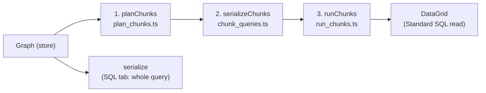

# How Spaghetti materialization works

This doc follows one graph through every stage of the pipeline. All plans,
hashes and SQL below are **real output from the current code**, not
hand-written examples.



| Stage | Pure? | Input | Output |
|---|---|---|---|
| Node generators | yes | config + input references | SQL / PSN fragment |
| 1. `planChunks` | yes | graph + target node | chunks of node ids, cut at expensive nodes |
| `serialize` | yes | graph + output node (+ nodes to read as tables) | one query string + its includes |
| 2. `serializeChunks` | yes | graph + chunks + dialect | each chunk's query, named by a Merkle hash |
| 3. `runChunks` | **no** | chunk queries + cache | tables in TraceProcessor |

Each stage has one job. Planning knows nothing about SQL or dialects,
serializing knows nothing about plans or caching, and only running touches the
engine. The cache only affects **which chunks are built**, never the plan or
the queries.

---

## The example graph

A single docked chain, with the **Limit** node selected:

```
From(slice)
  → Filter(dur > 1000)
  → Extend(dur / 1e6 AS dur_ms)
  → GroupBy(name; COUNT(*) AS cnt, SUM(dur_ms) AS total_ms)   ← expensive
  → Filter(cnt > 5)
  → Sort(total_ms DESC)                                        ← expensive
  → Limit(10)                                                  ← selected
```

Node ids: `src`, `flt1`, `ext`, `gb`, `flt2`, `srt`, `lim`.

---

## 0. Node generators

Each node manifest has `generators: {sql, psn?}`, plus an optional
`expensive: true`. Generators are pure. They receive the node's config and a
context giving access to the inputs (`ctx.input(port)`, `ctx.inputs()`), the
inputs' columns, and `sqlModules`.

**SQL fragments are structured clauses**, never full SQL strings to be parsed:

```ts
filter:  {where: 'dur > 1000'}
extend:  {select: ['*', 'dur / 1e6 AS dur_ms']}
groupby: {groupBy: ['name'], select: ['name', 'COUNT(*) AS cnt', 'SUM(dur_ms) AS total_ms']}
sort:    {orderBy: ['total_ms DESC']}
limit:   {limit: 10}
from:    {from: 'slice'}                       // a bare name: a plain reference
ii:      {from: '_interval_intersect!((a, b), (utid))', includes: [...]}
union:   {from: '(SELECT * FROM a UNION ALL SELECT * FROM b)'}
```

**PSN fragments are a source and/or stages:**

```ts
filter:  {stages: ['WHERE dur > 1000']}
from:    {source: 'FROM slice'}
ii:      {source: 'INTERVAL INTERSECTION OF (...)', stages: ['SELECT ...']}
union:   {stages: ['UNION ALL (...)']}  // continues the first input's pipeline
```

A generator may also return:
- **`undefined`**: the node is incomplete, e.g. a required input isn't
  connected or a required field is empty. There is no separate validity check;
  the generator is the only judge.
- **`{error}`**: the node can't be expressed in this dialect.
- **`{}`**: an empty fragment, meaning a passthrough (e.g. a sort with no
  columns).

**Includes** come from the fragments themselves. The From node looks its table
up in `sqlModules` and returns e.g. `includes: ['slices.with_context']` for
`thread_slice`. Each generator is called once per serialization, so there is
only one source of includes.

---

## 1. Plan (`plan_chunks.ts`)

`planChunks(index, targetId)` walks **upstream** from the target and splits the
graph into **chunks**: the units that each become one query.

- **One rule cuts chunks: `expensive`.** Every expensive node roots a chunk,
  and the target roots the output chunk.
- **Every other node joins the chunk of each expensive node (or the target)
  downstream of it.** A cheap node read from several chunks is repeated in each
  of them.
- **Expensive nodes are memoized,** so an expensive node read twice is still
  one chunk.
- **Purely structural.** No SQL, no dialect, no completeness check: an
  incomplete node is chunked like any other, and serialization reports it. It
  returns `undefined` only for an unknown node type or a cycle.

The plan just groups node ids. It doesn't decide what gets materialized; that's
up to the materializer.

```json
{
  "chunks": [
    {"rootId": "gb",  "nodeIds": ["src", "flt1", "ext", "gb"], "inputs": []},
    {"rootId": "srt", "nodeIds": ["flt2", "srt"],              "inputs": ["gb"]},
    {"rootId": "lim", "nodeIds": ["lim"],                      "inputs": ["srt"]}
  ],
  "outputId": "lim"
}
```

Chunks are in dependency order (inputs first, the output chunk last), so no
separate topological sort is needed.

---

## 2. Serialize (`serialize*.ts`)

`serialize(index, outputId, dialect, {tables, sqlModules})` turns **any** graph
upstream of an output node into one query. It knows nothing about plans, chunks
or caching:

- **`tables`** maps node ids to table names. Those nodes are read by name, and
  nothing upstream of them is walked or rendered. That one option covers every
  use: no `tables` gives the whole query (the SQL tab), a chunk's inputs give
  just that chunk, and the output node itself gives `SELECT * FROM <table>`.
- **The result** is `{sql, includes, relation?}` or `{error, nodeId}`. The
  includes are reported separately from the query. `relation` is set when the
  query just reads one named relation.
- **Columns:** generators that need their inputs' columns (e.g. Drop in
  Standard SQL) get them from the graph, so a node read as a table still
  reports its columns.

The shared walk and generator context live in
[serialize_common.ts](./serialize_common.ts), with one file per dialect.

### Standard SQL: clause-order folding ([serialize_sql.ts](./serialize_sql.ts))

Nodes are rendered inputs first. Each node's output is either an **open
SELECT block** (later nodes can still fold into it) or a **name** (a table, a
bare relation, or an emitted CTE).

- **Folding:** a fragment folds into its primary input's block if every clause
  it adds comes **later** in SQL evaluation order than the block's latest clause
  (`FROM`, `WHERE`, `GROUP BY`, `SELECT`, `DISTINCT`, `ORDER BY`, `LIMIT`), and
  **nothing else reads that input**. `WHERE` + `WHERE` is ANDed.
- **A node becomes a CTE** (named `<type>_<n>`) when:
  - it's read more than once in the query, so it's written once and both
    readers use the name;
  - it's read through another port, or by a fragment with its own `from`
    (joins, union, interval ops, the SQL node);
  - folding would break clause order (e.g. a group-by after an extend, or a
    filter after a group-by).
- **A bare table reference is never a CTE**; it's just referenced by name.
- **An empty fragment** passes its input through unchanged.
- **No hidden side effects:** a node's other inputs are named before its
  generator runs. If a fragment turns out to bring its own `from`, its primary
  is named and the generator is called again with the real name.

The whole example graph as one query (what the SQL tab shows):

```sql
WITH
extend_1 AS (
  SELECT
    *,
    dur / 1e6 AS dur_ms
  FROM slice
  WHERE dur > 1000
),
groupby_1 AS (
  SELECT
    name,
    COUNT(*) AS cnt,
    SUM(dur_ms) AS total_ms
  FROM extend_1
  GROUP BY name
)
SELECT *
FROM groupby_1
WHERE cnt > 5
ORDER BY total_ms DESC
LIMIT 10
```

The extend can't fold into the group-by (its `SELECT` comes after `GROUP BY` in
evaluation order), so `extend_1` becomes a CTE. The second filter, the sort and
the limit all fold into the final `SELECT`.

### PerfettoSQL Next: stage appending ([serialize_psn.ts](./serialize_psn.ts))

PSN needs no folding, because pipe stages already map one-to-one onto nodes:
- **A `stages` fragment** is appended to the primary input's pipeline.
- **A `source` fragment** starts a new pipeline.
- **A pipeline read more than once is repeated**, since PSN has no CTEs.
- **An input used as a source** is written as a table name, or as the
  pipeline in parentheses. A pipeline that is just `FROM (<plain SQL>)` is used
  as that subquery directly.

```
FROM slice
|> WHERE dur > 1000
|> EXTEND dur / 1e6 AS dur_ms
|> AGGREGATE COUNT(*) AS cnt, SUM(dur_ms) AS total_ms GROUP BY name
|> WHERE cnt > 5
|> ORDER BY total_ms DESC
|> LIMIT 10
```

> [!WARNING]
> The PSN docs say a pipeline can't yet appear inside a subquery. A chunk that
> nests a cheap input pipeline as a source (a union's second input, interval
> intersect operands, a repeated pipeline) may be rejected by TraceProcessor.

---

## 3. Chunk queries and hashes (`chunk_queries.ts`)

`serializeChunks(index, plan, {dialect, sqlModules})` serializes each chunk in
plan order, passing the chunk's inputs as `tables`, each named by the hash
already worked out for it:

```
hash = "_qb_" + fnv(dialect + "\n" + includes + "\n" + sql)
```

**It's a Merkle hash.** Inputs appear in the SQL under their own hashes, so a
change anywhere upstream renames an input and changes every hash downstream.
The dialect is part of the hash, so the two dialects never share tables, and so
are the includes, so a table isn't reused if its modules changed. Because the
hash is of the exact query that builds the table, two identical subgraphs
anywhere on the canvas share one table.

Standard SQL:

```sql
-- _qb_324566e1 (root: gb)
WITH
extend_1 AS (
  SELECT
    *,
    dur / 1e6 AS dur_ms
  FROM slice
  WHERE dur > 1000
)
SELECT
  name,
  COUNT(*) AS cnt,
  SUM(dur_ms) AS total_ms
FROM extend_1
GROUP BY name

-- _qb_171cdcd6 (root: srt), reads _qb_324566e1
SELECT *
FROM _qb_324566e1
WHERE cnt > 5
ORDER BY total_ms DESC

-- _qb_e087f3df (root: lim), reads _qb_171cdcd6
SELECT *
FROM _qb_171cdcd6
LIMIT 10
```

PSN:

```
-- _qb_ba3e9372 (root: gb)
FROM slice
|> WHERE dur > 1000
|> EXTEND dur / 1e6 AS dur_ms
|> AGGREGATE COUNT(*) AS cnt, SUM(dur_ms) AS total_ms GROUP BY name

-- _qb_f5c00c00 (root: srt), reads _qb_ba3e9372
FROM _qb_ba3e9372
|> WHERE cnt > 5
|> ORDER BY total_ms DESC

-- _qb_fbc60733 (root: lim), reads _qb_f5c00c00
FROM _qb_f5c00c00
|> LIMIT 10
```

### The output

- **`isOutputMaterialized(index, plan)`** decides the output policy: only an
  expensive output is worth building into a table. A cheap one (like `lim`
  here) is read straight from its inputs' tables, so its chunk has a hash but
  is never built.
- **`outputQuery(index, plan, chunks, dialect)`** gives the query that reads
  the output, in any dialect. It's just `serialize` with `tables` set to the
  output node itself (if materialized) or the output chunk's inputs (if not).

The Materialization tab shows every chunk and the output in the configured
dialect. The DataGrid always reads with `outputQuery(..., 'sql')`, because it
wraps its source in plain SQL, which can't contain a pipe query:

```sql
SELECT *
FROM _qb_171cdcd6
LIMIT 10
```

---

## 4. Run and cache (`run_chunks.ts`, `materialization_service.ts`)

The cache is a map from hash to cache entry. The table for hash `h` in
TraceProcessor is named `h`.

**`runChunks(engine, chunks, materializeOutput, cache, hooks)`:**
1. **Work out the needed chunks:** walk back from what the output reads (its
   own table if materialized, otherwise its inputs), **stopping at any chunk
   that's already cached**. Ancestors of a cached chunk aren't needed, even if
   they've been evicted.
2. **Build the needed chunks in plan order:**
   - **Already cached:** a hit. No SQL runs.
   - **Not cached:** one statement, with the chunk's includes in it:
     ```sql
     DROP TABLE IF EXISTS h;
     INCLUDE PERFETTO MODULE <each include>;
     CREATE PERFETTO TABLE h AS
     <chunk query>
     ```
   - **Not needed at all:** marked skipped.
3. **Return** the built entries, the hits and each chunk's outcome. The cache is
   only read; a failed run still returns what it built, so every table is
   tracked.

**Run outcomes** for each chunk: `building` → `built` (with time) / `hit` /
`skipped`. The Materialization tab shows these as badges, and the canvas glow
comes from them: a node whose chunk is `building` gets the animated glow, and
`built` gets a one-shot CSS fade.

**`MaterializationService`** runs plan → serialize → run whenever the graph,
selection or dialect changes, then:
- records hits (last-hit time and hit count) and the new entries in the cache;
- creates the DataGrid's `SQLDataSource` from the Standard SQL output query,
  with that query's includes as its `preamble`;
- skips the whole run if nothing changed: the run is identified by the dialect
  plus every chunk's hash and query.

**Eviction (least recently used):**
- All cache tables share one cap, `maxEntries` (default 16). After each run
  (never mid-run), anything over the cap is dropped, oldest last hit first.
- The tables the current output query reads are never evicted.
- Re-running a plan only needs its most downstream cached chunk, so dropping
  older upstream tables never causes a rebuild cascade, even when a plan has
  more chunks than the cap.
- Drops wait for in-flight DataGrid queries on the shared task queue.

---

## Edit scenarios: what the cache reuses

Starting from the example above in Standard SQL, with `gb` and `srt` cached
(`_qb_324566e1`, `_qb_171cdcd6`). These are real results:

| Edit | Chunk hashes that change | What runs |
|---|---|---|
| **B:** Limit 10 → 20 | only the (unbuilt) output chunk | No `CREATE`; the read becomes `SELECT * FROM _qb_171cdcd6 LIMIT 20` |
| **C:** cnt > 5 → 50 | `srt` (`_qb_547fdb70`) and the output | One `CREATE` (the sort chunk, reading the cached `_qb_324566e1`) |
| **D:** dur > 1000 → 5000 | all (`_qb_52e94ac5`, `_qb_e7f5e0ec`) | Both chunks are rebuilt |
| **E:** select `flt2` instead | none built (`flt2` is a cheap output) | No `CREATE`; the read is `SELECT * FROM _qb_324566e1 WHERE cnt > 5` |
| **F:** select `srt` instead | none (`srt` is now the output, and expensive) | No `CREATE`; the read is `SELECT * FROM _qb_171cdcd6` |
| **G:** switch to PSN | all (`_qb_ba3e9372`, `_qb_f5c00c00`) | Both chunks are rebuilt as PSN tables; the read is still Standard SQL |

Notes on these results:
- **Editing a cheap node after the last expensive one** (B) never builds a
  table; only the output read changes.
- **Reverting an edit** (e.g. cnt back to 5) gets an instant hit on the old
  table, if it hasn't been evicted, because it renders the same query.
- **Selecting a different node** (E, F) reuses every table upstream of it. The
  cheap nodes after the last table run in the DataGrid's read query on every
  page fetch, which is the trade-off of not materializing cheap outputs.
- **Switching dialect** (G) starts from a cold cache for that dialect.
  Switching back reuses the other dialect's tables if they haven't been
  evicted.

---

## A shared node within one chunk

`From(slice) → Filter(dur > 0)` feeding **both** inputs of a Union, with a
Limit after it. The union is expensive, so the filter stays in the union's
chunk:

```
  uni chunk: [src, flt, uni]
  l chunk:   [l]  (output, reads uni)
```

Standard SQL (`_qb_ea58b357`): the shared filter is written once as a CTE.

```sql
WITH
filter_1 AS (
  SELECT *
  FROM slice
  WHERE dur > 0
)
SELECT *
FROM (
  SELECT * FROM filter_1
  UNION ALL
  SELECT * FROM filter_1
)
```

PerfettoSQL Next (`_qb_322fd832`): no CTEs, so the pipeline is repeated. The
union is a pipe stage on the first input's pipeline. This uses the proposed
`|> UNION` syntax, which TraceProcessor doesn't support yet.

```
FROM slice
|> WHERE dur > 0
|> UNION ALL (
  FROM slice
  |> WHERE dur > 0
)
```

---

## Where things live

| Concern | File |
|---|---|
| Fragment types, `NodeGenerators`, `expensive` flag | [node_types.ts](./node_types.ts) |
| Per-node SQL / PSN generators | `nodes/*.ts` |
| Shared SQL helpers and types | [sql_types.ts](./sql_types.ts), [generator_utils.ts](./generator_utils.ts) |
| Graph index, input resolution, column inference | [graph_utils.ts](./graph_utils.ts) |
| Chunking (cut at expensive nodes) | [plan_chunks.ts](./plan_chunks.ts) |
| Serializing a graph to one query | [serialize.ts](./serialize.ts), [serialize_common.ts](./serialize_common.ts), [serialize_sql.ts](./serialize_sql.ts), [serialize_psn.ts](./serialize_psn.ts) |
| Chunk queries, Merkle hashes, output policy and output query | [chunk_queries.ts](./chunk_queries.ts) |
| Building chunks into tables | [run_chunks.ts](./run_chunks.ts) |
| Running on graph changes, cache, eviction, DataGrid source | [materialization_service.ts](./materialization_service.ts) |
